# Demo 真机验证记录

## 1. 验证说明

- **验证目标**：逐项核对根据官方文档生成的 Demo，其代码实现与真机表现是否符合对应开发指南。
- **验证依据**：各工程生成代码时使用的官网冻结快照与判据文件；若改用新版文档，另行记录版本及对应代码。
- **结论范围**：仅覆盖本文记录的文档版本、代码版本、设备和验证点。
- **填写方式**：验证点为待核对清单，按实际判据补充或拆分；对比实验合并为一条验证点，在同一条内记录各配置的结果。
- **历史报告**：原自动验证结果按实际覆盖范围引用；模拟器截图不作为本次真机视觉通过证据。
- **官网修复跟踪**：问题发现日期按 2026-09-10 记录；官网更新日期为 2026-09-14；修复状态记录更新日期为 2026-09-15。原实测结果与官网修复状态分别保留，官网已修复不等同于真机复测通过。

| 状态 | 含义 |
|---|---|
| 待验证 | 尚未执行 |
| 通过 | 实际结果符合文档预期，且有对应证据 |
| 不通过 | 满足验证前提，但实际结果与预期不一致 |
| 无法判定 | 设备能力、环境或证据不足 |
| 不适用 | 不适用于当前场景，需注明原因 |

实现符合性填写“符合 / 不符合 / 无法判定 / 待核对”；真机效果逐项使用上述验证状态。疑似文档问题需记录具体条目和证据，不由单次效果异常直接判定。

## 2. 验证总览

| 编号 | 工程目录 | Demo 名称 | 已通过 / 适用验证点数 | 实现符合性 | 真机效果一致性 | 明细 |
|---|---|---|---|---|---|---|
| D01 | `1/` | 底部页签与索引条沉浸光感 | 1 / 4（2 项不通过、1 项无法判定） | 当前核心配置符合 | D01-02 官网 2026-09-14 已修复，待复测；其余问题修复状态待核实 | [详情](#d01) |
| D02 | `2/` | 弹窗类组件沉浸光感 | 3 / 5（1 项不通过、1 项无法判定） | 生成基线符合体 | Toast、Popup、Menu 及多数 Dialog 结果可判定；bindSheet 应用级开启异常，Tips 未取证 | [详情](#d02) |
| D03 | `3/` | 按钮与选择类组件沉浸光感 | 3 / 6（2 项不通过、1 项无法判定） | 生成基线符合 | Select、Toggle、Slider 通过；ChipGroup 未观察到相对 DISABLE 的材质差异；SegmentButton DEFAULT 表现异常；Button 动态效果证据不足 | [详情](#d03) |
| D04 | `4/` | Button 沉浸光感生效区域 | 4 / 4 | 生成基线符合 | 应用级 ENABLE、标题栏组件级 THIN / lightEffect、全局 DISABLE 符合 | [详情](#d04) |
| D05 | `6/` | 搜索框与内容区标题栏沉浸光感 | 2 / 2 | 生成基线符合 | 搜索框标题栏与内容区标题迁入场景均核验通过；本轮无截图或录屏附件 | [详情](#d05) |
| D06 | `7/` | FAQ 材质遮挡解决方案 | 3 / 3 | 符合 | 背景色、背景模糊和不透明 materialColor 的问题复现及推荐方案均通过真机对照 | [详情](#d06) |
| D07 | `8/ImmersiveLightDemo/` | HDS 标题栏与底部页签沉浸光感 | 2 / 2 | 当前核心 HDS API 接入符合 | 标题栏按钮与底部悬浮页签沉浸光感均核验通过，且与既有自动设备验证结论一致；本轮无截图或录屏附件 | [详情](#d07) |
| D08 | `Express/` | Express 标题栏与导航 Tab 沉浸光感 | 2 / 2 | 工作树相对自动报告增加了页签交互、流光、阴影及惯用手适配配置 | 标题栏与手机端底部悬浮 TabBar 均核验通过；本轮无截图或录屏附件 | [详情](#d08) |
| D09 | `BookRead/` | BookRead HDS 沉浸光感 | 1 / 3（2 项不通过；标题栏视觉不适用） | 核心 HDS 接入符合 | 有效宽度配置下底部页签材质通过；HdsTabs `barWidth='100%'` 与 `barHeight='auto'` 均破坏悬浮材质，且官方文档未说明限制与优先级 | [详情](#d09) |
| D10 | `Express2/` | Express 材质反色、赋色、交互与阴影 | 5 / 5 | 自动反色、半透明赋色、交互、圆形材质和系统材质阴影接入均符合 | 5 项均核验通过，且与既有自动设备验证结论一致 | [详情](#d10) |

## 3. 真机验证环境

同一环境可被多个 Demo 引用；设备、系统或关键设置变化时新增环境记录。SDK / HDS 版本存在工程差异时，在对应 Demo 基本信息中补充。

| 环境编号 | 真机型号 | HarmonyOS 完整版本 | SDK / API 版本 | HDS 版本（如适用） | 材质能力检测方式及结果 | 主题、字体及显示缩放等设置 |
|---|---|---|---|---|---|---|
| ENV-01 | HUAWEI Mate XT 2 | 待填写 | 真机为 API 26；各工程 targetSdkVersion / compatibleSdkVersion 见对应 Demo 明细（D08、D10 为 26.0.0 / 6.0.0(20)） | 不适用（ArkUI 路线） | D04 页面截图直接显示 `isImmersiveMaterialSupported=true`、`getGlobalMaterialLevel=EXQUISITE（高算力）`，且标题栏流光效果可见；未留存独立 hilog 输出 | 主题、字体及显示缩放待填写 |

## 4. Demo 验证明细

### D01 底部页签与索引条沉浸光感

#### 基本信息

| 项目 | 内容 |
|---|---|
| Demo 介绍 | 展示底部页签与索引条相关沉浸光感效果。本次重点验证底部页签材质、应用级开关影响，以及默认参数与显式材质样式的差异。 |
| 工程目录 | `1/` |
| 页面入口与操作路径 | 启动应用进入“首页”；滚动彩色卡片列表，观察底部悬浮页签；点击“联系人”进入索引条页面。 |
| 验证环境 | HUAWEI Mate XT 2 |
| 工程 SDK / API / HDS 版本 | 当前工程 targetSdkVersion、compatibleSdkVersion 均为 26.0.0；本实验使用 ArkUI |
| 本次验证范围 | 底部页签材质；索引提示弹窗及背景模糊对比（全局 ENABLE）；底部页签全局 DISABLE / ENABLE / DEFAULT 对比；默认参数 / ULTRA_THIN / THIN 对比 |

#### 验证点

**D01-01：底部页签材质效果**

验证操作：使 barFloatingStyle 悬浮样式生效，观察彩色内容上方的页签。

文档预期：根据[组件适配沉浸光感：底部页签（Tabs）](https://developer.huawei.com/consumer/cn/doc/harmonyos-guides/arkts-immersive-light-sense-component-adaptation)，可通过 [barFloatingStyle](https://developer.huawei.com/consumer/cn/doc/harmonyos-references/ts-container-tabs#barfloatingstyle) 中的 FloatingTabBarStyle.systemMaterial 设置底部页签材质。悬浮样式需同时满足 barOverlap=true、vertical=false、barPosition=BarPosition.End，生效后可呈现沉浸光感。

真机结果：底部页签能实现沉浸光感，呈现通透背板及悬浮效果。

验证状态：**通过**。

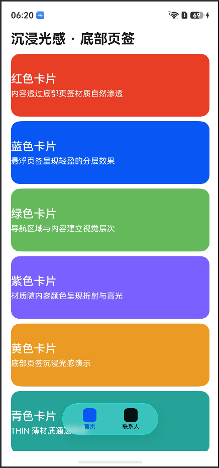

**D01-02：索引提示弹窗 systemMaterial THIN / 背景模糊对比**

问题发现日期：2026-09-10。

官网修复状态：**官网 2026-09-14 已修复（用户确认）**；修复后的真机复测结果待补充。

状态记录日期：2026-09-15。

验证操作：全局沉浸光感开关设为 ENABLE，进入联系人页并触发索引提示弹窗。第一组显式配置 `.systemMaterial(new uiMaterial.ImmersiveMaterial({ style: uiMaterial.ImmersiveStyle.THIN }))`；第二组配置 `.popupBackgroundBlurStyle(BlurStyle.NONE)`，对比两组效果。

文档预期：根据[组件适配沉浸光感：索引条（AlphabetIndexer）](https://developer.huawei.com/consumer/cn/doc/harmonyos-guides/arkts-immersive-light-sense-component-adaptation)，应用级开关为 ENABLE 时，索引条默认开启沉浸光感，默认材质为 THICK；也可通过 systemMaterial 主动设置沉浸光感效果。popupBackground、popupBackgroundBlurStyle 与沉浸光感互斥，主动设置后不再显示沉浸光感效果。

真机结果：第一张图显式设置 systemMaterial 为 THIN，但实测没有沉浸光感效果，仅显示浅色提示弹窗背板；第二张图设置 popupBackgroundBlurStyle 为 BlurStyle.NONE 后，实测有效果，弹窗周围的明暗过渡更明显。两组测试的全局开关均已开启。

原实测状态：**不通过（按实测记录，systemMaterial THIN 未呈现预期效果）**。第二组有效果，但背景模糊本身也会产生视觉变化，是否属于沉浸光感仍需区分；该现象记录为疑似文档或实现差异。

| systemMaterial：THIN，全局 ENABLE，无效果 | popupBackgroundBlurStyle：BlurStyle.NONE，全局 ENABLE，有效果 |
| :---: | :---: |
| 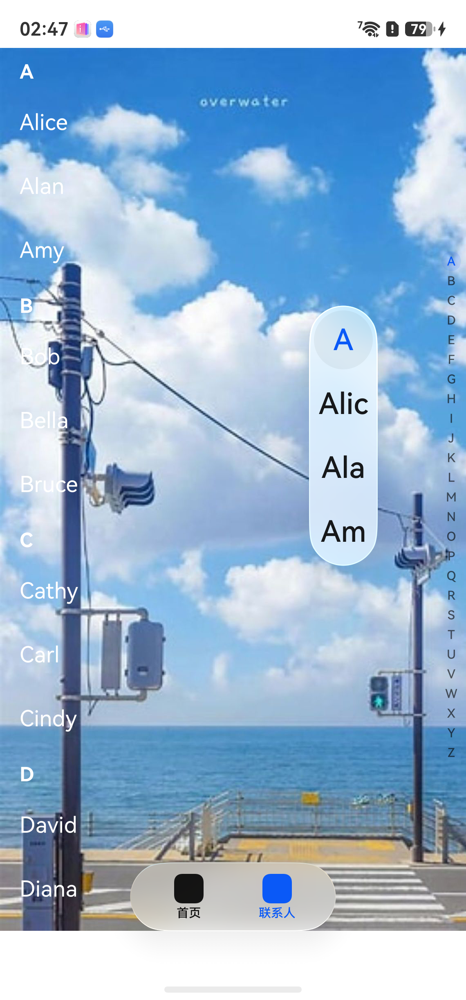 | 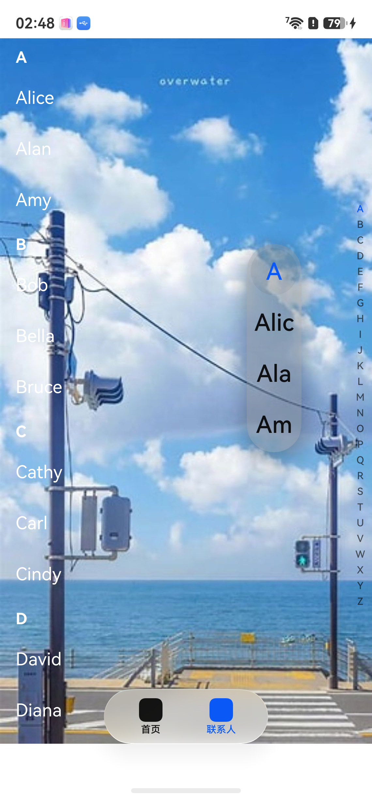 |

**D01-03：全局 DISABLE / ENABLE / DEFAULT 对比**

问题发现日期：2026-09-10。

官网修复状态：待核实（官网 2026-09-14 更新后尚未确认是否修复）。

状态记录日期：2026-09-15。

验证操作：保持底部页签配置不变，分别将应用级沉浸光感配置设为 DISABLE、ENABLE、DEFAULT，观察底部页签效果。

文档预期：[组件适配沉浸光感：底部页签（Tabs）](https://developer.huawei.com/consumer/cn/doc/harmonyos-guides/arkts-immersive-light-sense-component-adaptation)说明，[应用级开关 MaterialState](https://developer.huawei.com/consumer/cn/doc/harmonyos-references/arkts-apis-uimaterial#materialstate) 为 ENABLE 时，底部页签不会仅因此默认开启沉浸光感；设置 [barFloatingStyle](https://developer.huawei.com/consumer/cn/doc/harmonyos-references/ts-container-tabs#barfloatingstyle) 且悬浮样式生效时，底部页签默认开启沉浸光感。该段未单独说明本次组件配置下 DISABLE、DEFAULT 的覆盖关系，需结合组件级配置核对。

真机结果：三种已测取值下沉浸光感均开启，效果基本一致。本次实测认为底部页签的沉浸光感开启由 barFloatingStyle 配置决定。

验证状态：**无法判定（对比已完成，整体规范符合性待核对）**。其中 ENABLE 下的开启效果符合预期，DISABLE、DEFAULT 的配置覆盖关系待核对。

| E01：DISABLE | E02：ENABLE | E03：DEFAULT |
| :---: | :---: | :---: |
| 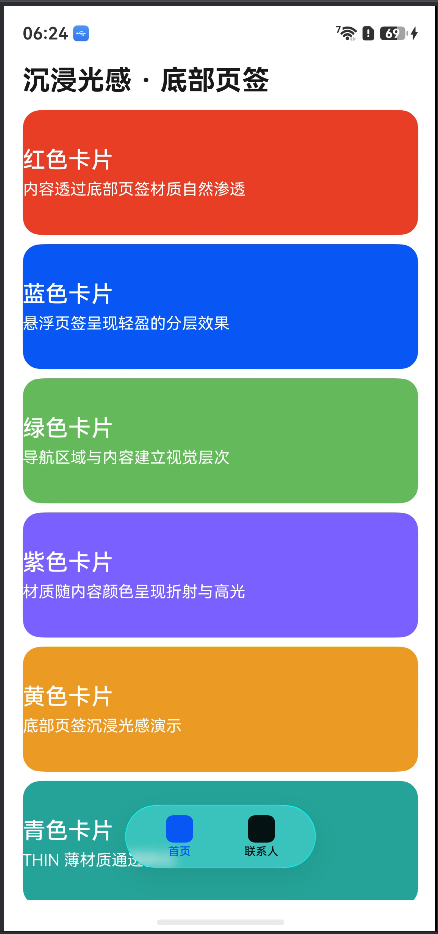 |  | 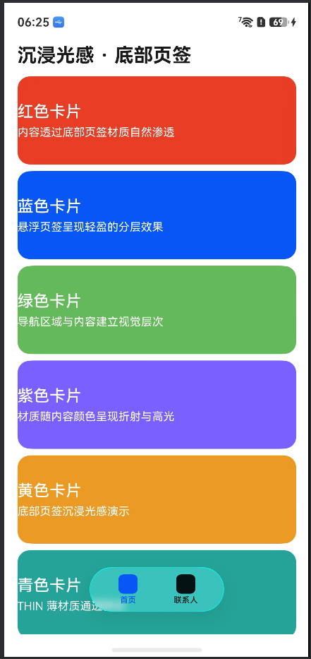 |

**D01-04：默认参数 / THIN / ULTRA_THIN 对比**

问题发现日期：2026-09-10。

官网修复状态：待核实（官网 2026-09-14 更新后尚未确认是否修复）。

状态记录日期：2026-09-15。

验证操作：分别使用 barFloatingStyle 默认参数、显式 THIN、显式 ULTRA_THIN，观察青色与橙色内容交界处的材质效果。

文档预期：[组件适配沉浸光感：底部页签（Tabs）](https://developer.huawei.com/consumer/cn/doc/harmonyos-guides/arkts-immersive-light-sense-component-adaptation)明确说明，设置 [barFloatingStyle](https://developer.huawei.com/consumer/cn/doc/harmonyos-references/ts-container-tabs#barfloatingstyle) 且悬浮样式生效后，沉浸式系统材质样式默认取值为 THIN。因此默认效果应与同条件下显式 THIN 一致；通过 FloatingTabBarStyle.systemMaterial 显式设置时，按指定材质样式呈现效果。

真机结果：默认参数效果与显式 THIN 不一致；THIN 与 ULTRA_THIN 均有材质效果，外观存在差异。

验证状态：**不通过（默认效果与 THIN 不一致，疑似文档问题）**。

| E04：默认参数 | E05：THIN | E06：ULTRA_THIN |
| :---: | :---: | :---: |
|  |  |  |

#### 符合性结论

| 结论项 | 结果 | 依据 / 说明 |
|---|---|---|
| 代码实现是否符合开发指南 | 当前代码的底部页签核心配置符合；各实测变体待补充核对 | [Index.ets](1/entry/src/main/ets/pages/Index.ets) 使用 BarPosition.End、barOverlap(true)、barFloatingStyle.systemMaterial 显式 THIN；vertical 未设置，沿用默认值。当前代码不能代表所有截图对应变体。 |
| 底部页签能否实现沉浸光感 | 通过 | 用户实测与 E01–E03 支持底部页签材质生效。 |
| 全局开关影响 | 三种已测取值效果基本一致且均开启 | 用户实测认为本场景由 barFloatingStyle 配置决定开启。结论限于本次 DISABLE、ENABLE、DEFAULT 及已测组件配置，不扩展到所有参数组合。 |
| 索引提示弹窗是否符合文档 | 原实测不通过；官网 2026-09-14 已修复 | 用户确认官网已修复。原实测为全局 ENABLE 下 systemMaterial THIN 无效果、popupBackgroundBlurStyle(BlurStyle.NONE) 有效果；修复后的真机复测结果待补充。 |
| 默认材质是否符合文档 | 不通过，存在疑似冲突 | 用户实测默认参数效果与显式 THIN 不一致，与“默认取值为 THIN”的描述存在差异。 |
| 未覆盖项及结论限制 | 待补充 | 完整系统版本、各配置代码及安装包标识未提供；默认参数对比截图的裁剪与背景相对位置存在差异。未设置 barFloatingStyle 的对照结果尚未提供。 |

### D02 弹窗类组件沉浸光感

#### 基本信息

| 项目 | 内容 |
|---|---|
| Demo 介绍 | 验证即时反馈 Toast、气泡提示 Popup/Tips、菜单 Menu，以及 AlertDialog、CustomDialog、ActionSheet、bindSheet 的沉浸光感；对比应用级 ENABLE / DISABLE / DEFAULT 与组件级显式材质。 |
| 工程目录 | `2/` |
| 页面入口与操作路径 | 启动应用进入“弹窗类组件沉浸光感 Demo”；点击“显示 Toast”“气泡 Popup”“打开菜单”或四个 Dialog 按钮。 |
| 验证环境 | HUAWEI Mate XT 2 |
| 工程 SDK / API / HDS 版本 | ArkUI；targetSdkVersion、compatibleSdkVersion 均为 26.0.0；不使用 HDS。 |
| 验证日期 / 验证人 | 2026-09-15 / 验证人待填写 |
| 本次验证范围 | Toast、Popup、Menu、AlertDialog、CustomDialog、ActionSheet、bindSheet；应用级 ENABLE / DISABLE / DEFAULT；组件级默认构造参数与指定 THICK、ULTRA_THIN 或 ULTRA_THICK。Tips 无截图，未纳入通过数。 |

#### 验证点

**D02-01：即时反馈（Toast）**

验证操作：依次构建应用级 ENABLE、DISABLE、DEFAULT 且不显式设置 ShowToastOptions.systemMaterial 的变体，再在组件级分别使用默认 ImmersiveMaterial 构造参数与显式 THICK，点击“显示 Toast”。

文档预期：ENABLE 下 Toast 默认开启沉浸光感，默认样式为 THICK；DEFAULT 下 Toast 在未设置背景色、模糊和阴影参数时默认开启；DISABLE 下不开启。组件级可通过 ShowToastOptions.systemMaterial 主动指定材质。

真机结果：ENABLE、DEFAULT 与显式 THICK 均呈浅蓝半透明材质，DISABLE 为普通近白色背板；显式默认构造参数呈更明显的蓝色材质，与 THICK 有可辨别差异。结果符合文档预期。

验证状态：**通过**。

**D02-02：气泡提示（Popup；Tips 未取证）**

验证操作：在未显式设置 PopupOptions.systemMaterial 时对比应用级 ENABLE、DEFAULT；再显式指定 THICK、ULTRA_THIN 并点击“气泡 Popup”。

文档预期：同一小节先称 Popup/Tips 支持应用级与组件级开启，紧接着又称 ENABLE 下不会默认开启；MaterialState.ENABLE 默认清单未包含 Popup/Tips。可执行判据按后一句处理：必须通过 PopupOptions.systemMaterial / TipsOptions.systemMaterial 显式开启。

真机结果：ENABLE 与 DEFAULT 均为普通近白色 Popup，未见沉浸材质；显式 THICK 后出现浅蓝材质边缘和赋色，显式 ULTRA_THIN 后底图透出及模糊最明显。实测支持“Popup 不会由应用级 ENABLE 默认开启、需组件级设置”的结论，并反证“支持应用级开启”的笼统表述。

验证状态：**通过**。

**D02-03：菜单（Menu）**

验证操作：不显式设置 ContextMenuOptions.systemMaterial，分别以 ENABLE、DISABLE、DEFAULT 打开菜单；再显式使用默认构造参数、THICK、ULTRA_THIN 对比。

文档预期：ENABLE 下 Menu 默认开启并使用 THICK；DISABLE 下关闭；MaterialState.DEFAULT 未将普通 Menu 列为默认开启组件。组件级可显式指定样式。

真机结果：ENABLE 呈浅蓝材质，DISABLE 与 DEFAULT 为普通近白色背板；显式默认构造参数、THICK、ULTRA_THIN 均呈材质，且 REGULAR、THICK、ULTRA_THIN 透明度和模糊程度存在明显差异。结果符合文档预期。

验证状态：**通过**。

**D02-04：弹出框（AlertDialog、CustomDialog、ActionSheet、bindSheet）**

验证操作：四类弹出框分别对比应用级 ENABLE、DISABLE、DEFAULT（不显式设置 options.systemMaterial），再显式使用默认构造参数与 ULTRA_THICK。

文档预期：组件适配页将 AlertDialog、CustomDialog、bindSheet 等归为 Dialog，称 ENABLE 下弹出框默认开启、默认样式 ULTRA_THICK；MaterialState.DEFAULT 也将 Dialog 列为默认开启；均可通过 options.systemMaterial 组件级开启。

真机结果：AlertDialog、CustomDialog、ActionSheet 在 ENABLE、DEFAULT 下呈浅蓝材质，DISABLE 下为普通近白色背板；显式默认构造参数与 ULTRA_THICK 均生效且外观不同。bindSheet 的显式默认构造参数与 ULTRA_THICK 可见材质，但应用级 ENABLE、DEFAULT、DISABLE 三张截图的 Sheet 背板均接近普通白色，未观察到 ENABLE 应有的默认材质差异。

验证状态：**不通过**。AlertDialog、CustomDialog、ActionSheet 子项通过；bindSheet 应用级 ENABLE 子项不符合“弹出框默认开启”的预期，组件级开启通过。正文仅展示不通过项的应用级对比证据 D02-E31～D02-E33。

不通过证据对照：应用级 ENABLE、DEFAULT、DISABLE 下的 bindSheet 背板均接近普通白色，ENABLE 未呈现文档所述的默认沉浸材质。组件级显式材质复核已通过，其截图不在正文展示。

| D02-E31：ENABLE（未观察到默认材质） | D02-E32：DEFAULT（未观察到默认材质） | D02-E33：DISABLE（无材质） |
| :---: | :---: | :---: |
| 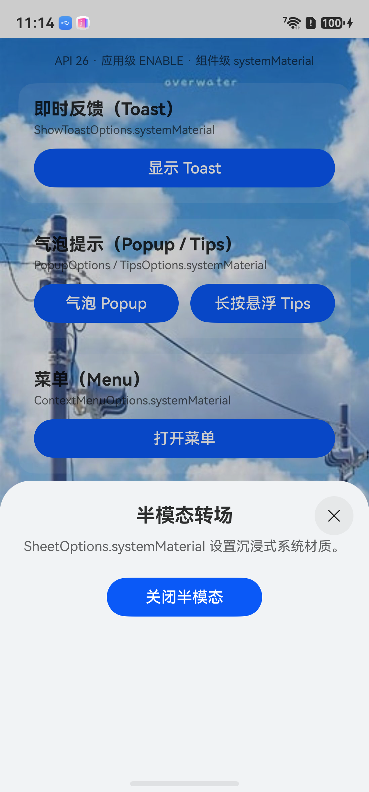 | 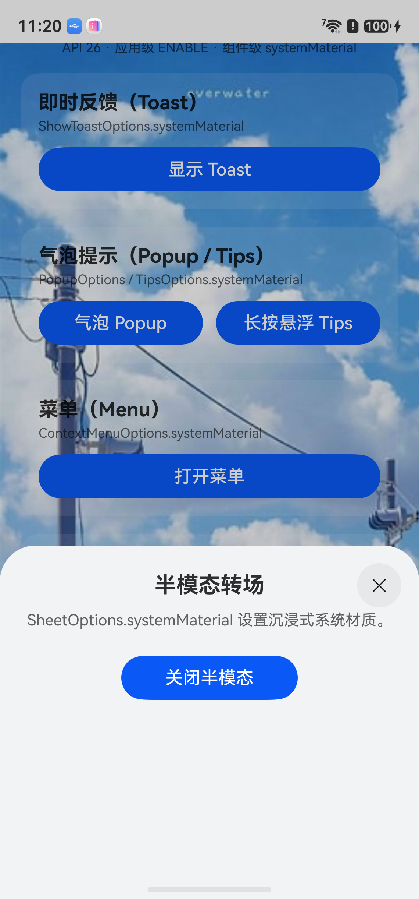 | 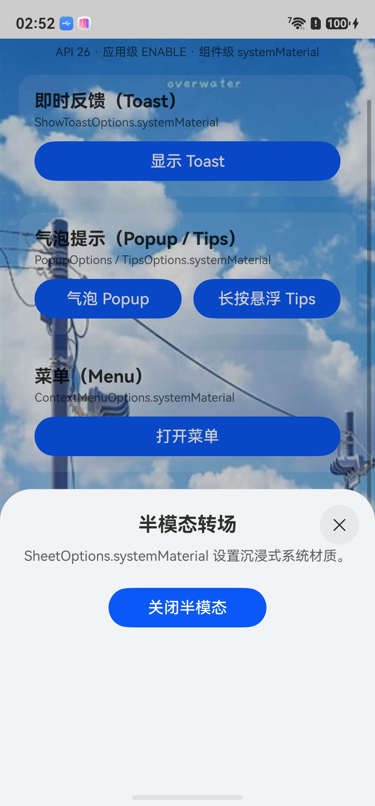 |

**D02-05：应用级开关跨组件效果对比**

| 组件 / 接口 | ENABLE | DEFAULT | DISABLE | 组件级显式材质 | 对照结论 |
|---|---|---|---|---|---|
| Toast | 有材质 | 有材质 | 无材质 | 有材质 | 符合 |
| Popup | 无材质 | 无材质 | 未取证 | THICK、ULTRA_THIN 均有材质 | 与“ENABLE 不默认开启”一致；与“支持应用级开启”冲突 |
| Tips | 未取证 | 未取证 | 未取证 | 未取证 | 无法判定 |
| Menu | 有材质 | 无材质 | 无材质 | REGULAR、THICK、ULTRA_THIN 均有材质 | 符合 |
| AlertDialog | 有材质 | 有材质 | 无材质 | REGULAR、ULTRA_THICK 均有材质 | 符合 |
| CustomDialog | 有材质 | 有材质 | 无材质 | REGULAR、ULTRA_THICK 均有材质 | 符合 |
| ActionSheet | 有材质 | 有材质 | 无材质 | REGULAR、ULTRA_THICK 均有材质 | 符合；显式变体保留半透明 materialColor |
| bindSheet | 未观察到材质 | 未观察到材质 | 无材质 | REGULAR、ULTRA_THICK 均有材质 | ENABLE 与文档预期不一致 |

#### 符合性结论

| 结论项 | 结果 | 依据 / 说明 |
|---|---|---|
| 代码实现是否符合开发指南 | 生成基线符合；当前变体存在记录一致性问题 | 自动报告确认 API 26、应用级 metadata、各 options.systemMaterial、背景属性规避、弹窗尺寸和半透明 materialColor 等判据。 |
| 真机效果是否符合文档预期 | 部分符合 | Toast、Menu、AlertDialog、CustomDialog、ActionSheet 通过；Popup 组件级开启通过且应用级不默认开启；bindSheet 组件级通过但应用级 ENABLE 不通过；Tips 无法判定。 |
| 是否发现疑似文档问题 | 是，1 项已确认、1 项待进一步复测 | （1）Popup/Tips 同一小节“支持应用级开启”与“ENABLE 不会默认开启”直接冲突，Popup 真机结果支持后者（DOC-012）；（2）文档将 bindSheet 纳入 ENABLE 下默认开启的 Dialog，但本次 ENABLE 截图与 DISABLE/DEFAULT 接近，仅显式 systemMaterial 生效。 |
| 应用级 DISABLE 语义 | 本组实测支持“全局禁用默认材质” | Toast、Menu、三类 Dialog 的 DISABLE 均回落普通背板。由于本组 DISABLE 截图对应的是未显式设置组件级材质的对照，不能单凭这些截图解决“DISABLE 是否同时压制组件级显式材质”的 DOC-001 冲突。 |
| 材质样式差异 | 可见，但不作参数强度的绝对排序 | REGULAR、THICK、ULTRA_THIN/ULTRA_THICK 在同类组件中呈现不同的透明度、赋色和模糊外观；静态截图受背景位置、遮罩和组件默认样式影响，只证明“存在差异”。 |
| 未覆盖项及结论限制 | Tips、动态效果及可审计构建映射未覆盖 | 未提供 Tips 触发态截图、录屏、完整系统版本、材质等级检测日志、各截图对应的提交号/HAP 哈希或逐变体代码快照；页面副标题未随配置切换；因此不验证流光/形变，也不把静态颜色差异外推到其他设备。 |

### D03 按钮与选择类组件沉浸光感

#### 基本信息

| 项目 | 内容 |
|---|---|
| Demo 介绍 | 验证 Button、Select、Toggle、Slider、ChipGroup、SegmentButton / SegmentButtonV2 的应用级默认开启、组件级显式材质及组件专属约束。 |
| 工程目录 | `3/` |
| 页面入口与操作路径 | 启动应用进入“沉浸光感 · 按钮与选择类组件”；首屏观察 Button、Select、Toggle、Slider，向下滚动观察 ChipGroup 与 SegmentButton；点击 Select 展开菜单并切换各选择控件。 |
| 验证环境 | HUAWEI Mate XT 2 |
| 工程 SDK / API / HDS 版本 | ArkUI；targetSdkVersion、compatibleSdkVersion 均为 26.0.0；不使用 HDS。 |
| 验证日期 / 验证人 | 2026-09-15 / 验证人待填写 |
| 本次验证范围 | Button 应用级开关旁证；Select 按钮与菜单；Toggle 的 Switch、Button 形态；Slider；ChipGroup 普通/选中/图标入口；SegmentButton 与 SegmentButtonV2；应用级 ENABLE / DISABLE / DEFAULT 及显式默认构造参数、THIN / ULTRA_THIN。 |

#### 验证点

**D03-01：按钮（Button）**

验证状态：**见D04**。

**D03-02：下拉按钮（Select）与下拉菜单**

验证操作：目标 Select 不显式设置 systemMaterial / menuSystemMaterial，分别对比应用级 ENABLE、DEFAULT、DISABLE；再显式使用默认 ImmersiveMaterial 构造参数、按钮 ULTRA_THIN 与菜单 THICK，并展开首个 Select 的菜单。

文档预期：ENABLE 下 Select 按钮与菜单默认开启，按钮默认 ULTRA_THIN 且默认启用 interactive / lightEffect，菜单默认 THICK；DEFAULT 下不在默认开启清单，DISABLE 下关闭。按钮 systemMaterial 与菜单 menuSystemMaterial 相互独立，可用 Material.empty 单独关闭。

真机结果：按钮在 ENABLE 下出现明亮边缘与半透明材质，DEFAULT、DISABLE 下接近普通样式；显式默认构造参数和 ULTRA_THIN 均可见材质。展开菜单后，ENABLE、显式默认构造参数与 THICK 呈浅蓝半透明材质，DEFAULT、DISABLE 接近普通白色菜单。应用级状态和组件级入口的核心结果符合预期。

验证状态：**通过**。

**D03-03：开关（Toggle）**

验证操作：分别对 ToggleType.Switch 与 ToggleType.Button 比较应用级 ENABLE、DEFAULT、DISABLE，以及显式默认构造参数和 THIN；页面同时保留一个 Material.empty 的 Switch 对照。

文档预期：ENABLE 下 Toggle 默认开启，DEFAULT 下不默认开启，DISABLE 下关闭；Switch 的材质参数仅作开关标记，实际采用组件内部预设视觉参数；Button 形态效果与 Button 组件相同；Checkbox 当前不适配。

真机结果：Switch 在 ENABLE 和组件级显式材质下出现明显放大的发光滑块及外圈，DEFAULT、DISABLE 下为普通滑块；显式默认构造参数与 THIN 外观基本一致，符合“参数仅作开启标记”。ToggleType.Button 的显式材质可见描边和半透明背景，应用级状态差异弱于 Switch，但未出现与文档相反的结果。

验证状态：**通过**。Checkbox 未实现，按官方“不适配”说明不纳入本 Demo 通过数；动态点击反馈无录屏，不作结论。通过项截图不在正文展示，原始文件保留在 `screenshots/3/Toggle/`。

**D03-04：滑动条（Slider）**

验证操作：在 SliderBlockType.DEFAULT、SliderStyle.OutSet 条件下，比较应用级 ENABLE、DEFAULT、DISABLE及显式默认构造参数、ULTRA_THIN。

文档预期：ENABLE 下 Slider 默认开启；DEFAULT 下不默认开启，DISABLE 下关闭；组件级传入有效材质对象开启。材质参数仅作开关标记，实际采用内部预设视觉参数；交互反馈仅在 DEFAULT 滑块形状且 SliderStyle 不为 NONE 时生效。

真机结果：ENABLE、显式默认构造参数与 ULTRA_THIN 均显示尺寸明显增大、带发光外圈的滑块；DEFAULT、DISABLE 为普通小滑块。不同显式材质参数下外观接近，符合“仅作开关标记”的描述。

验证状态：**通过**。

**D03-05：子页签（ChipGroup）**

问题发现日期：2026-09-15。

官网修复状态：待核实。

状态记录日期：2026-09-15。

验证操作：在普通项、选中项和右侧图标保持同一展示结构的条件下，比较应用级 ENABLE、DEFAULT、DISABLE，以及组件级显式默认构造参数（REGULAR）和 ULTRA_THIN。应用级状态变体不显式设置目标 ChipGroup 的三个材质入口；组件级变体同时设置 backgroundSystemMaterial、selectedBackgroundSystemMaterial 和 iconBackgroundSystemMaterial。

文档预期：ENABLE 下 ChipGroup 默认开启，默认样式 ULTRA_THIN；DEFAULT 下不在默认开启清单。组件级可分别通过 backgroundSystemMaterial、selectedBackgroundSystemMaterial 和 iconBackgroundSystemMaterial 设置普通、选中、图标背景材质。

真机结果：五种变体中的 ChipGroup 外观仍基本一致：选中项“推荐”均为实色蓝色胶囊，未选中项均为浅灰半透明背景，右侧图标均为实色蓝色圆形背景。ENABLE、显式 REGULAR、显式 ULTRA_THIN 均未相对 DISABLE 呈现可辨别的材质边缘、背景折射/模糊或透明度变化；ENABLE 也未表现出应与显式 ULTRA_THIN 对应的默认材质差异。DEFAULT 与 DISABLE 接近符合“不默认开启”的预期，但这也反向说明其余三种开启配置没有产生可见效果。

验证状态：**不通过**。应用级 ENABLE 默认开启与组件级显式材质均未表现出相对 DISABLE 的可辨别变化。该结果证明本次组合配置的视觉结果不符合预期，但由于三个入口同时切换且逐变体代码快照/HAP 哈希未固化，暂不能定位是 ChipGroup 整体、某个入口、实验构建映射还是设备实现问题。

不通过证据对照：ENABLE 和显式 ULTRA_THIN 下的普通项、选中项及图标背景均与 DISABLE 基本一致。DEFAULT、显式 REGULAR 的截图结论相同，原始文件保留在 `screenshots/3/ChipGroup/`，正文不重复展示。

| D03-E21：ENABLE（未观察到默认材质差异） | D03-E22：ULTRA_THIN（未观察到显式材质差异） | D03-E23：DISABLE（普通组件样式基线） |
| :---: | :---: | :---: |
| 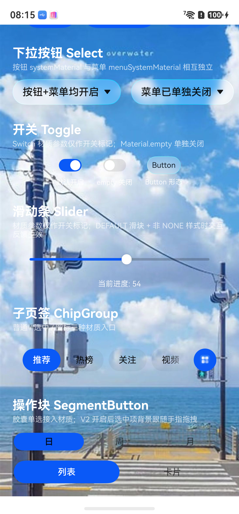 | 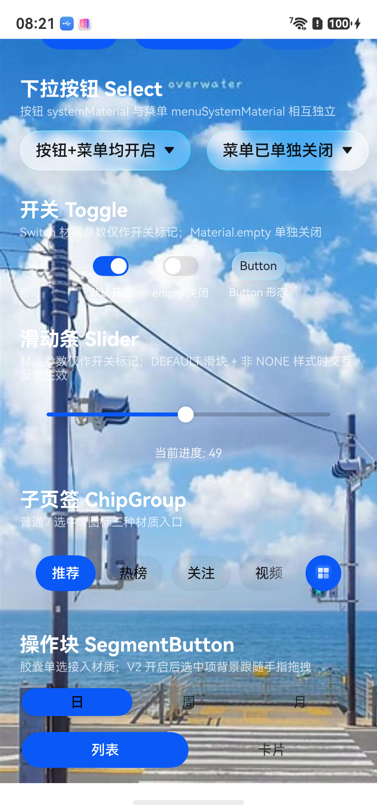 | 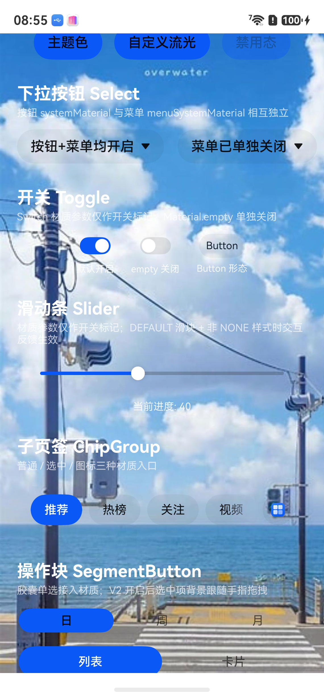 |

**D03-06：操作块（SegmentButton / SegmentButtonV2）**

问题发现日期：2026-09-15。

官网修复状态：待核实。

状态记录日期：2026-09-15。

验证操作：对胶囊单选 SegmentButton 比较应用级 ENABLE、DEFAULT、DISABLE及显式默认构造参数、THIN；同时观察 CapsuleSegmentButtonV2 静态效果。

文档预期：ENABLE 下 SegmentButton / SegmentButtonV2 默认开启，默认样式 THIN；DEFAULT 下二者不在默认开启清单，应由应用主动设置；DISABLE 下关闭。胶囊类型仅 `multiply: true` 的多选组合不支持 backgroundSystemMaterial，本 Demo 为 `multiply: false`，应支持。SegmentButtonV2 开启后还应支持选中项背景跟随手指拖拽。

真机结果：SegmentButton 的 ENABLE、显式默认构造参数和 THIN 均呈半透明胶囊背景；DISABLE 下选中项回落为普通实色蓝色。异常在于 DEFAULT 截图中的选中项仍呈现与 ENABLE、显式材质近似的半透明背景，并与 DISABLE 明显不同，不符合 MaterialState.DEFAULT“其他组件由应用主动设置”的预期。SegmentButtonV2 在各静态截图中的选中项均接近实色蓝色，且无拖拽录屏，不能独立判定 V2 材质和跟手能力。

验证状态：**不通过（SegmentButton 的 DEFAULT 子项）**。

不通过证据对照：DEFAULT 下的 SegmentButton 顶部“日/周/月”仍呈半透明材质，外观与 ENABLE 接近；DISABLE 下选中项为普通实色蓝色。显式默认构造参数和 THIN 属通过项，其截图不在正文展示。

| D03-E31：DEFAULT（异常呈现材质） | D03-E32：ENABLE（预期呈现材质） | D03-E33：DISABLE（普通实色样式） |
| :---: | :---: | :---: |
| 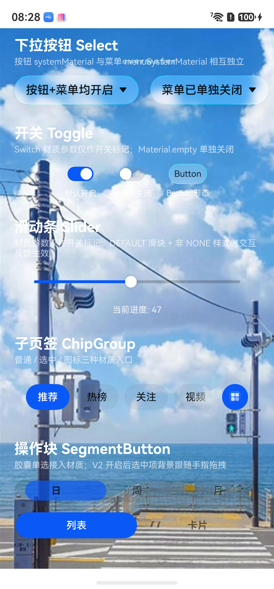 | 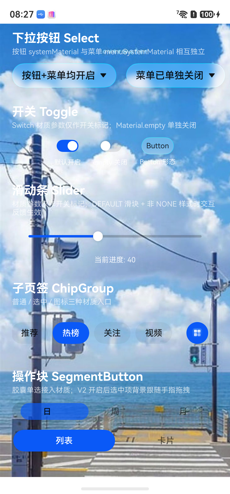 | 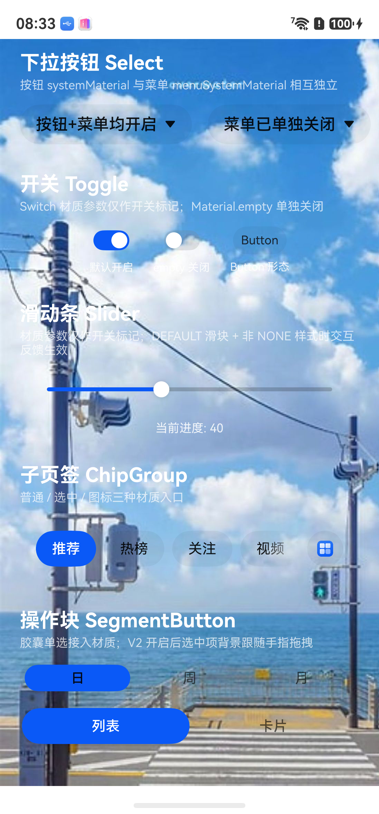 |

**D03-07：应用级开关与显式材质跨组件对照（汇总项，不计入验证点总数）**

| 组件 | ENABLE | DEFAULT | DISABLE | 组件级显式材质 | 对照结论 |
|---|---|---|---|---|---|
| Select 按钮 | 有材质 | 普通样式 | 普通样式 | REGULAR、ULTRA_THIN 有材质 | 符合 |
| Select 菜单 | 有材质 | 普通样式 | 普通样式 | REGULAR、THICK 有材质 | 符合 |
| ToggleType.Switch | 有材质 | 普通样式 | 普通样式 | REGULAR、THIN 有材质 | 符合；材质样式参数仅作开启标记 |
| ToggleType.Button | 可见材质但差异较弱 | 接近普通样式 | 接近普通样式 | REGULAR、THIN 可见材质 | 未见反例；静态判定弱于 Switch |
| Slider | 有材质 | 普通样式 | 普通样式 | REGULAR、ULTRA_THIN 有材质 | 符合；材质样式参数仅作开启标记 |
| ChipGroup | 未观察到相对 DISABLE 的材质差异 | 与 DISABLE 接近 | 普通组件样式 | REGULAR、ULTRA_THIN 均未观察到相对 DISABLE 的材质差异 | 不通过；应用级及组件级开启均未产生可辨别变化 |
| SegmentButton | 有材质 | 异常呈现材质 | 无材质 | REGULAR、THIN 有材质 | DEFAULT 与文档预期不一致 |

#### 符合性结论

| 结论项 | 结果 | 依据 / 说明 |
|---|---|---|
| 代码实现是否符合开发指南 | 生成基线符合；当前工作树仅代表最终实验变体 | 自动报告的 C01–C20 与实现记录覆盖六类组件、应用级 metadata、组件级接口、Material.empty、Slider 形态条件及 SegmentButton 单选限制。当前代码已改为 DISABLE，Button 的 systemMaterial 被注释，且 ChipGroup 选中材质样式有调整，不能代表所有截图。 |
| 真机效果是否符合文档预期 | 部分符合：3 项通过、2 项不通过、1 项无法判定 | Select、Toggle、Slider 的静态对照通过；ChipGroup 的 ENABLE 与组件级显式材质均未相对 DISABLE 产生可辨别变化；SegmentButton DEFAULT 子项不通过；Button 组件级/动态效果无法判定。 |
| 是否发现疑似文档问题 | 是，1 项文档内冲突已确认；2 项真机差异待复测 | （1）Button“支持应用级开启”与“ENABLE 不会默认开启”冲突，实测支持后者；（2）ChipGroup 在 ENABLE、显式 REGULAR、显式 ULTRA_THIN 下均与 DISABLE 接近；（3）SegmentButton 在 DEFAULT 下仍呈与 ENABLE 接近的材质。 |
| Material.empty 与组件独立控制 | 实现已覆盖 | 代码包含 Select.menuSystemMaterial(Material.empty) 与 Toggle.systemMaterial(Material.empty)。 |
| 未覆盖项及结论限制 | Checkbox、ChipGroup 三入口独立控制、逐变体构建映射及完整设备信息未覆盖 | Checkbox 官方明确不适配；ChipGroup 三个材质入口在现有实验中同时切换，尚未分别做单入口开关对照。 |

### D04 Button 沉浸光感生效区域

#### 基本信息

| 项目 | 内容 |
|---|---|
| Demo 介绍 | 在同一 NavDestination 中设置标题栏 Button（A 组）与内容区 Button（B 组），并以内容区 Slider / Toggle / Select（C 组）作清单内对照，验证 Button 的沉浸光感是否受标题栏 / 底部 TabBar 生效区域限制。 |
| 工程目录 | `4/` |
| 页面入口与操作路径 | 启动应用进入唯一页面；观察顶部标题栏 A1“纯材质”和 A2“流光”、内容区 B“内容区Button”及 C 组对照；分别点击标题栏 A2 与内容区 B，并切换 ENABLE、显式默认构造参数、显式 THIN、DISABLE 变体。 |
| 代码版本 / 安装包标识 | 各截图变体未固化提交号、源代码快照或 HAP 哈希；当前工作树为 `module.json5=disable`、Button 显式 THIN 的最终变体，不能代表全部截图。 |
| 验证环境 | HUAWEI Mate XT 2 |
| 工程 SDK / API / HDS 版本 | ArkUI；targetSdkVersion、compatibleSdkVersion 均为 26.0.0；不使用 HDS。 |
| 验证日期 / 验证人 | 2026-09-17 / 验证人待填写 |
| 本次验证范围 | Button 应用级 ENABLE 默认行为；标题栏与内容区的组件级显式材质；THIN + interactive + lightEffect；应用级 DISABLE；C 组清单内组件旁证。底部 TabBar 未实现，hilog 未留存。 |

#### 验证点

**D04-01：应用级 ENABLE 不会默认开启 Button**

验证操作：在应用级 ENABLE 变体中观察标题栏 A1 / A2 与内容区 B，不以组件级显式材质作为默认开启条件；同时观察 C 组 Select 等清单内组件。

文档预期：MaterialState.ENABLE 的默认开启清单不含 Button，Button 小节也明确“按钮不会默认开启沉浸光感”，因此仅设置 ENABLE 时 Button 应保持普通组件样式；这与同小节前一句“支持通过应用级开启”构成文档内部冲突。

真机结果：`TitleEnable.png`、`ContentEnable.png` 中 A1、A2、B 均保持普通蓝色 Button；C 组 Select 可见材质边缘，可排除“应用整体材质能力未开启”的简单解释。结果支持“ENABLE 不默认开启 Button”。

验证状态：**通过**。。

**D04-02：标题栏内 Button 的组件级 THIN / lightEffect**

验证操作：标题栏 A1 设置 THIN 纯材质，A2 设置 THIN、`interactive: true`、`lightEffect: {}`；在标题栏点击 A2 并记录按压阶段。

文档预期：Button 位于 NavDestination 标题栏，处于明确生效范围；组件级 systemMaterial 应生效，A2 的默认点击态应由材质流光反馈替代。

真机结果：`TitleTHIN.png` 中 A2 出现从中心向两侧过渡的亮色流光 / 高亮和浅色边缘，A1、B 仍为普通蓝色；页面同时显示设备支持为 true、材质等级为 EXQUISITE。标题栏内的组件级 THIN + lightEffect 有可见响应。

验证状态：**通过**。

**D04-03：内容区 Button 的生效范围**

问题发现日期：2026-09-10。

官网修复状态：待核实。

状态记录日期：2026-09-17。

验证操作：内容区 B 显式设置材质并点击，对比标题栏与内容区截图；以应用级 DISABLE 作为普通 Button 基线。

文档预期存在两套口径：D04-REF-01 / 03 将 Button 归入“其他组件”，预期仅标题栏 / 底部 TabBar 生效、内容区不生效；D04-REF-02 仅说明 Button 可通过 systemMaterial 设置效果，没有复述区域限制，按该小节独立阅读会预期内容区也生效。

真机观察：THIN 组中，标题栏 A2 的流光可见，而点击内容区 B 后仍是普通蓝色外观；内容区 B 与 DISABLE 基线也未见明显差异。表象支持“Button 内容区不生效”的范围清单口径。

验证状态：**通过**。

**D04-04：应用级 DISABLE 全局禁用显式材质**

验证操作：保持组件级材质入口，应用级状态改为 DISABLE，分别点击标题栏与内容区 Button。

文档预期：MaterialState.DISABLE 禁止所有组件开启材质，即使组件显式设置 systemMaterial 也不生效。

真机结果：`TitleDisable.png`、`ContentDisable.png` 中标题栏与内容区 Button 均保持普通蓝色，未出现 THIN 组标题栏 A2 的流光；C 组 Select 也回落为普通样式。结果支持 DISABLE 的全局禁用语义。

验证状态：**通过**。

**D04-05：显式默认构造参数与对照组**

#### 符合性结论

| 结论项 | 结果 | 依据 / 说明 |
|---|---|---|
| 代码实现是否符合开发指南 | 核心接入符合；区域对照设计不充分 | [Index.ets](4/entry/src/main/ets/pages/Index.ets) 使用 API 26 的能力查询、标题栏 / 内容区 Button、systemMaterial、Slider / Toggle / Select 对照，且 systemMaterial 位于尺寸 / 圆角之后。问题在于 A2 与 B 的材质对象和尺寸不同，页面“同一材质对象与尺寸”的说明与代码不一致；A1 还未显式设置 height。 |
| 真机效果是否符合文档预期 | 4 项通过 | ENABLE 不默认开启 Button、标题栏 THIN + lightEffect、DISABLE 全局禁用符合可执行判据；内容区 Button 的无效果表象符合范围清单。 |
| 是否发现疑似文档问题 | 是，2 项既有问题获得旁证 | （1）DOC-002：Button 小节未写区域限制，而五处范围清单均把 Button 排除在全页面生效枚举外；本次表象支持受限口径，但证据链尚不足以最终裁决。（2）DOC-013：Button 首句称支持应用级开启，后句及 MaterialState.ENABLE 清单却表明不会默认开启；ENABLE 实测支持后者。 |
| DISABLE 语义 | 真机结果支持“全局禁用” | 标题栏显式组件级材质在 DISABLE 下也无流光，与 MaterialState.DISABLE 及开启指南第 75 行一致；这也为 DOC-001 的“全局禁用”一侧提供补充旁证。 |
| 未覆盖项及结论限制 | 底部 TabBar、越界日志、严格同变量复测及动态录屏未覆盖 | 未保存逐变体 module.json5 / Index.ets、HAP 哈希与 hilog；八张截图均为单帧，无法完整验证弹性形变或流光轨迹；标题栏 / 内容区探针尺寸和材质配置不一致；完整系统版本、主题、字体、显示缩放仍待填写。 |

### D05 搜索框与内容区标题栏沉浸光感

#### 基本信息

| 项目 | 内容 |
|---|---|
| Demo 介绍 | 复现官方“沉浸光感典型场景”的两种信息浏览页面：探索页在搜索框标题栏中展示 Search、分类 ChipGroup 和悬浮底部 Tabs，并随上滑收缩；游戏页将内容区分类标题在滚动到阈值后迁入 NavDestination 标题栏显示。 |
| 工程目录 | `6/` |
| 页面入口与操作路径 | 启动应用默认进入底部“探索”页签，观察搜索框、分类列表和悬浮底部页签后向上滑动；再点击底部“游戏”页签，切换分类并向上滑动，观察内容区分类标题迁入标题栏，随后回滑观察恢复。 |
| 代码版本 / 安装包标识 | 自动报告保留生成基线和构建 / 安装 / 运行证据。当前工作树额外配置 `ohos.arkui.UIMaterial.state=disable`，属于后续测试变体，不能代表本次“通过”所对应的配置。 |
| 验证环境 | HUAWEI Mate XT 2 |
| 工程 SDK / API / HDS 版本 | ArkUI；targetSdkVersion、compatibleSdkVersion 均为 26.0.0；不使用 HDS。 |
| 验证日期 / 验证人 | 2026-09-17 / 人工核验人待填写 |
| 本次验证范围 | 探索页 Search / ChipGroup / 底部 Tabs 材质、STACK 透底、GRADUAL_BLUR 与上滑联动；游戏页内容区标题迁入 / 回迁、原位置显隐、标题栏 Button 与分类 ChipGroup 材质。未对不同材质样式、应用级状态矩阵或动态性能做对比。 |

#### 验证点

**D05-01：搜索框标题栏沉浸光感与上滑联动**

验证操作：启动后停留在“探索”页，观察标题栏 Search、分类 ChipGroup 和底部悬浮 Tabs；向上滑动内容区，观察标题栏高度、Search 透明度、分类区域及透底 / 模糊效果。

文档预期：Search 通过 systemMaterial 显示沉浸材质，分类 ChipGroup 通过 backgroundSystemMaterial 显示材质；标题栏使用 STACK 和 GRADUAL_BLUR，内容通过 contentStartOffset 避让；上滑时标题栏显示范围缩小、Search 隐藏，分类列表保留；底部 Tabs 以 barFloatingStyle 显示悬浮材质。

真机结果：确认搜索框、分类列表和底部悬浮页签均呈现预期沉浸光感；向上滑动时搜索框随标题栏收缩并隐藏，分类列表保留，透底与渐进模糊表现正常，未发现遮挡、错位或交互异常。

验证状态：**通过**。

**D05-02：内容区标题迁入标题栏并显示沉浸光感**

验证操作：切换到“游戏”页，观察初始内容区分类标题与标题栏 AI 搜索按钮；向上滑动至分类标题到达标题栏区域，再回滑，观察分类组件迁入 / 回迁、原位置显隐和标题栏材质效果。

文档预期：页面通过 onShown 测量标题与内容区分类组件位置，并在 onDidScroll 达到阈值时将 ClassifyComponent 切换到 NavDestination 标题栏；迁入时内容区原位置隐藏，回滑时恢复。迁入后的 ChipGroup 及标题栏 Button 通过各自组件级入口显示沉浸光感，外层 Row 不重复设置材质。

真机结果：核验确认分类标题可随滚动迁入标题栏，内容区原位置同步隐藏，回滑后恢复；标题栏中的分类项与 AI 搜索按钮呈现预期材质，页面滚动、页签切换和内容显示正常。

验证状态：**通过**。

#### 符合性结论

| 结论项 | 结果 | 依据 / 说明 |
|---|---|---|
| 代码实现是否符合开发指南 | 生成基线整体符合；当前工作树不是通过态配置 | [ExplorePage.ets](6/entry/src/main/ets/pages/ExplorePage.ets) 覆盖 Search 材质、标题栏收缩、STACK、GRADUAL_BLUR、contentStartOffset；[GamePage.ets](6/entry/src/main/ets/pages/GamePage.ets) 覆盖位置测量、标题迁入和显隐；[ClassifyComponent.ets](6/entry/src/main/ets/components/ClassifyComponent.ets) 覆盖 ChipGroup 材质。当前 module.json5 的 DISABLE 会关闭材质，应与通过态区分。 |
| 真机效果是否符合文档预期 | 2 / 2 通过 | 搜索框标题栏场景、内容区标题迁入场景均由用户确认通过 |
| 是否发现疑似文档问题 | 本次未新增；关联 DOC-002、DOC-003 | 游戏页初始内容区 ChipGroup 的材质入口受“按钮与选择类组件”生效范围枚举歧义影响；官方典型场景给 AI 搜索按钮传入不透明 `materialColor: '#d3d3d3'`，又与材质赋色规则冲突。两项均已在 review-report.md 记录，本次不重复新增。 |

### D06 FAQ 材质遮挡解决方案

#### 基本信息

| 项目 | 内容 |
|---|---|
| Demo 介绍 | 在同一静态图片背景上，以错误 / 推荐写法成组复现 FAQ 中“不透明背景色遮挡材质”“背景模糊覆盖材质”“materialColor 使用不透明颜色后材质滤镜消失”三个问题，并核对对应解决方案。 |
| 工程目录 | `7/` |
| 页面入口与操作路径 | 启动应用进入唯一页面；向下滚动，依次对比 FAQ1 的错误写法 A、错误写法 B、推荐写法，以及 FAQ2 的纯红错误写法和 50% 透明红推荐写法。 |
| 代码版本 / 安装包标识 | 当前 [Index.ets](7/entry/src/main/ets/pages/Index.ets) 与截图结构一致 |
| 验证环境 | HUAWEI Mate XT 2 |
| 工程 SDK / API / HDS 版本 | ArkUI；targetSdkVersion、compatibleSdkVersion 均为 26.0.0；不使用 HDS。 |
| 验证日期 / 验证人 | 2026-09-17 / 验证人待填写 |
| 本次验证范围 | FAQ1：不透明 backgroundColor、backgroundBlurStyle 与透明背景推荐写法；FAQ2：Color.Red 与 `#80FF0000`；同时核对属性顺序、生效区域、固定渲染尺寸及静态背景等前提。 |

#### 验证点

**D06-01：不透明背景色遮挡——问题复现与透明背景方案**

验证操作：两张 328×56、圆角 28 的 Column 使用同一 ULTRA_THIN 材质。错误卡片先调用 systemMaterial，再调用 `backgroundColor(Color.White)`；推荐卡片先设置 `backgroundColor(Color.Transparent)`，最后调用 systemMaterial，且不设置背景模糊。

文档预期：错误写法的不透明白色背景覆盖材质；推荐写法应透出背后的图片内容与材质边缘。通用属性顺序指南要求 systemMaterial 放在其他样式之后。

真机结果：`FAQ.png` 中错误写法 A 为均匀纯白卡片，背景图完全不可见；推荐卡片呈浅蓝半透明材质，卡片内部可辨识电线杆与天空背景，边缘有明显材质轮廓。错误复现与解决方案均符合预期。

验证状态：**通过**。

**D06-02：背景模糊遮挡——问题复现与移除模糊方案**

验证操作：错误卡片在 systemMaterial 后叠加 `backgroundBlurStyle(BlurStyle.COMPONENT_THICK)`；与未设置背景模糊的推荐卡片对比。

文档预期：额外背景模糊覆盖 / 干扰材质层，而且与材质自带的模糊重复处理；移除 backgroundBlurStyle 后应恢复沉浸材质。

真机结果：错误写法 B 呈普通浅色模糊背板，背景细节被明显抹平，与推荐卡片能透出背景内容、呈现材质边缘的表现不同；移除额外背景模糊的推荐方案有效。

验证状态：**通过**。

**D06-03：materialColor 不透明颜色——问题复现与半透明赋色方案**

验证操作：两张卡片保持 ULTRA_THIN、尺寸和圆角一致；错误卡片传入 `materialColor: Color.Red`，推荐卡片传入 `materialColor: '#80FF0000'`。

文档预期：纯不透明 Color.Red 会完全遮挡材质滤镜，只剩纯色背景；带 50% 透明度的红色应在透出背景的同时呈现红色色调。

真机结果：错误卡片为均匀纯红色，背景内容完全不可见；推荐卡片呈半透明红色渐变，能够辨识后方道路与景物，同时保留红色色调和材质边缘。两者差异清晰。

验证状态：**通过**。

#### 符合性结论

| 结论项 | 结果 | 依据 / 说明 |
|---|---|---|
| 代码实现是否符合开发指南 | 符合验证目的 | [Index.ets](7/entry/src/main/ets/pages/Index.ets) 同时实现三组负面 / 推荐对照，错误写法有意违反背景与模糊约束，推荐写法符合透明背景、systemMaterial 置后、半透明 materialColor、固定渲染尺寸和标题栏生效区域要求。静态检查因识别到有意设置的 backgroundBlurStyle 而 inconclusive，不能据此判为代码失败。 |
| 真机效果是否符合文档预期 | 3 / 3 通过 | 不透明背景色、额外背景模糊、纯不透明 materialColor 均成功复现问题；透明背景 / 移除模糊 / 半透明赋色均显示预期材质。 |
| 是否发现疑似文档问题 | 本次未新增；关联 DOC-003、DOC-005 | materialColor 对照支持 DOC-003 的技术结论；背景色对照只证明“systemMaterial 在前、backgroundColor 在后”会被遮挡，并不能解决 FAQ 无条件称背景色覆盖材质、API 又称高 / 中算力下生效材质会把既有背景色恢复透明的 DOC-005 范围歧义。 |
| 属性顺序影响 | 实测支持“systemMaterial 最后设置” | 错误 A 把 backgroundColor 放在 systemMaterial 后，推荐项把透明背景放在前、systemMaterial 放在最后；两者视觉差异符合 FAQ 的顺序排障建议。不能据此扩展为所有算力、所有组件、所有调用顺序下背景色都必然遮挡。 |
| 未覆盖项及结论限制 | 单设备、单样式、单张滚动截图 | 仅验证 ULTRA_THIN、Color.White、COMPONENT_THICK、Color.Red 与 `#80FF0000`；未覆盖低 / 中算力设备、其他透明度、其他模糊样式、自绘制组件、DEFAULT / ENABLE / DISABLE 矩阵。 |

### D07 HDS 标题栏与底部页签沉浸光感

#### 基本信息

| 项目 | 内容 |
|---|---|
| Demo 介绍 | 参照 HDS 自适应沉浸光感示例，在同一页面为 HdsNavigation 标题栏的返回按钮和 3 个菜单按钮、HdsTabs 底部悬浮页签配置 `systemMaterialEffect`，验证 HDS 两类官方材质入口。 |
| 工程目录 | `8/ImmersiveLightDemo/` |
| 页面入口与操作路径 | 启动应用进入唯一页面；观察顶部“沉浸光感”标题栏的返回按钮及 3 个菜单按钮；观察底部“闹钟 / 时钟 / 秒表”悬浮页签，并切换页签确认内容和选中态。 |
| 代码版本 / 安装包标识 | 以本轮工作树为准。当前 [Index.ets](8/ImmersiveLightDemo/entry/src/main/ets/pages/Index.ets) 的 HDS 材质配置与自动报告基线一致，仅内容图片由 `scenery` 调整为 `backimg` 并补充 `height('100%')`；未单独固化提交号或 HAP 哈希。 |
| 验证环境 | HUAWEI Mate XT 2 |
| 工程 SDK / API / HDS 版本 | Stage 模型；targetSdkVersion、compatibleSdkVersion 均为 6.1.0(23)；使用 `@kit.UIDesignKit` HDS API，具体 HDS 包版本未单独留存。 |
| 验证日期 / 验证人 | 证据留存于 2026-09-14；本轮核验记录日期 2026-09-21 / 验证人待填写 |
| 本次验证范围 | HDS 版本和模型前提；标题栏返回按钮及 3 个菜单按钮的 ADAPTIVE / ADAPTIVE 材质；GRADIENT_BLUR 固定 originalStyle；底部页签悬浮布局四项条件、ADAPTIVE / ADAPTIVE 材质、三页签切换和选中态。未覆盖显式 IMMERSIVE、各固定 MaterialLevel、深色模式、温控、动态滚动样式和多设备差异。 |

#### 验证点

**D07-01：HdsNavigation 标题栏按钮沉浸光感**

验证操作：启动页面，观察标题栏返回按钮及 3 个菜单按钮；代码中设置 `ScrollEffectType.GRADIENT_BLUR`、`enableScrollEffect:false`，并为 titleBar.style.systemMaterialEffect 显式指定 ADAPTIVE / ADAPTIVE。

文档预期：4 个标题栏按钮应获得随系统能力自适应的沉浸光感；标题栏不随内容滚动切换，仅生效 originalStyle，默认模糊半径为 12vp。

核验结果：当前工作树在运行时，返回按钮和 3 个菜单按钮均显示浅色半透明圆形材质背板，标题区域的渐变模糊与内容背景衔接正常；标题文字、按钮布局和点击区域未出现异常。

验证状态：**通过**。

**D07-02：HdsTabs 底部悬浮页签沉浸光感**

验证操作：观察页面底部“闹钟 / 时钟 / 秒表”页签，并尝试切换选中项；代码同时配置 `barOverlap(true)`、`vertical(false)`、`barPosition(BarPosition.End)` 和 `barFloatingStyle`，其中 barBottomMargin 为 28vp，systemMaterialEffect 为 ADAPTIVE / ADAPTIVE。

文档预期：页签栏应悬浮于 TabContent 上方并与屏幕边缘保持距离，背景呈自适应沉浸材质；切换后选中项图标和文字状态应更新。

核验结果：当前工作树运行时，底部页签呈完整圆角半透明悬浮背板，背景图片可透过材质显示，页签栏与左右及底部边缘保持间距并叠加在内容区上方；“闹钟 / 时钟 / 秒表”均可正常切换，选中图标和文字状态随之更新，材质未在切换过程中消失。

验证状态：**通过**。

#### 符合性结论

| 结论项 | 结果 | 依据 / 说明 |
|---|---|---|
| 代码实现是否符合开发指南 | 符合 | [Index.ets](8/ImmersiveLightDemo/entry/src/main/ets/pages/Index.ets) 完整设置标题栏和页签的两处 systemMaterialEffect；页签悬浮四项条件齐全；版本、Stage 模型和 phone 设备类型符合前提。当前工作树相对自动报告代码仅替换内容背景图片并补充高度，不改变 HDS 材质配置。 |
| 自动验证结果 | passed | static、SDK、build、install、runtime、visual 六层通过；组件树和历史设备截图支持标题栏模糊结构、菜单按钮结构以及底部页签悬浮 / 叠加布局生效。 |
| 真机效果是否符合文档预期 | 2 / 2 通过 | 标题栏返回按钮及 3 个菜单按钮的沉浸材质、渐变模糊和布局正常；底部悬浮页签的圆角半透明背板、内容透出、边距、叠加关系以及三页签切换 / 选中态均符合预期。本轮无截图或录屏附件。 |
| 是否发现疑似文档问题 | 未发现新增问题 | HDS 指南、HdsNavigation、HdsTabs 与 hdsMaterial 参考对版本、入口、默认值和 ADAPTIVE 推荐用法的描述互相一致。|
| 相关实现注意点 | 固定标题栏样式与自适应材质语义需区分 | `enableScrollEffect=false` 表示标题栏只应用 originalStyle，并不表示 GRADIENT_BLUR 或 systemMaterialEffect 失效；ADAPTIVE / ADAPTIVE 只承诺由系统自适应选择方案，不能从页面观感反推固定 MaterialType 或 MaterialLevel。 |

### D08 Express 标题栏与导航 Tab 沉浸光感

#### 基本信息

| 项目 | 内容 |
|---|---|
| Demo 介绍 | 在既有 Express 工程中，通过 API 26 动态兼容模块为自定义标题栏设置 ULTRA_THIN 材质，并为手机端底部悬浮 Tabs 设置 THIN 材质；同时保留 compatibleSdkVersion 20 设备的普通样式回退路径。 |
| 工程目录 | `Express/` |
| 页面入口与操作路径 | 启动应用进入 MainEntry 首页；观察顶部自定义标题栏和手机端底部“首页 / 查快递 / 福利 / 我的”四项悬浮页签；切换页签并触摸页签栏，确认材质持续存在且页面功能正常。 |
| 代码版本 / 安装包标识 | 当前工作树相对既有自动报告基线增加 `adaptToHandedness`、`applyShadow`、`interactive` 和 `lightEffect` 配置。 |
| 验证环境 | HUAWEI Mate XT 2 |
| 工程 SDK / API / HDS 版本 | Stage 模型；targetSdkVersion 26.0.0、compatibleSdkVersion 6.0.0(20)；ArkUI `uiMaterial` API 26 路线，不使用 HDS。 |
| 验证日期 / 验证人 | 2026-09-21 / 验证人待填写 |
| 本次验证范围 | 自定义标题栏 ULTRA_THIN 材质、手机端横向底部悬浮 TabBar THIN 材质、页签切换稳定性；同时静态核对 API 26 能力守卫、动态加载、手机 / 大屏响应式分支及内容避让。 |

#### 验证点

**D08-01：自定义标题栏沉浸光感**

验证操作：启动应用进入 MainEntry 首页，保持 NavDestination 自定义 title builder 和 `barStyle: BarStyle.STACK`；标题容器通过 AttributeModifier 设置 `ImmersiveStyle.ULTRA_THIN`，观察标题区域并切换四个主页签。

文档预期：自定义标题内容所在节点显示 ULTRA_THIN 沉浸材质，内容区延伸至标题栏区域；切换页签时标题内容和材质保持正常，不依赖只作用于返回键 / 非自定义 Menu 的 NavigationTitleOptions.systemMaterial。

核验结果：标题栏沉浸光感可见，标题文字随页签切换正常更新，内容区与 STACK 标题栏叠加关系正常，未出现标题重复、材质消失或页面异常。

验证状态：**通过**。

**D08-02：手机端底部悬浮 TabBar 沉浸光感**

验证操作：在手机横向底部页签分支确认 `barOverlap(true)`、`vertical(false)`、`barPosition(End)`，通过 `barFloatingStyle.systemMaterial` 设置 THIN 材质；依次点击“首页 / 查快递 / 福利 / 我的”，观察悬浮背板、内容透出及页签交互。

文档预期：三个悬浮条件同时满足时，TabBar 背板显示 THIN 沉浸材质并叠加在内容区上方；TabContent 不单独设置材质，底部内容通过布局避让保持可用。

核验结果：底部四项页签均位于悬浮材质背板内，背景内容可透出；四个页签可正常切换，材质在切换和触摸过程中保持生效，页面底部内容未被页签栏不可用地遮挡。

验证状态：**通过**。

#### 符合性结论

| 结论项 | 结果 | 依据 / 说明 |
|---|---|---|
| 代码实现是否符合开发指南 | 符合 | [ImmersiveCompat.ets](Express/products/entry/src/main/ets/utils/ImmersiveCompat.ets) 在 API 26 和能力检测通过后一次性创建 ULTRA_THIN / THIN 材质；[MainEntry.ets](Express/products/entry/src/main/ets/pages/MainEntry.ets) 在自定义标题节点与 Tabs 上应用 modifier，并在手机分支满足悬浮三条件；[MainEntryVM.ets](Express/products/entry/src/main/ets/viewmodels/MainEntryVM.ets) 仅在 API 26 设备动态加载模块。 |
| 真机效果是否符合文档预期 | 2 / 2 通过| 标题栏材质与手机端底部悬浮 TabBar 均核验通过；四页签切换正常。无截图或录屏附件。 |
| 是否发现疑似文档问题 | 未发现新增问题 | 本次两项实际表现与标题栏、Tabs 接入规则一致；未观察到与冻结文档相反的结果。 |
| 相关实现注意点 | 响应式分支与低版本回退需保留 | 大屏分支使用 vertical=true、barPosition=Start、barOverlap=false，TabBar 不应套用手机悬浮表现；compatibleSdkVersion 20 要求继续使用 API 版本判断和动态 import，不能在低版本可加载模块中静态引用 uiMaterial。 |
| 未覆盖项及结论限制 | 缺少多场景对照 | 未单独验证 API 20 回退、大屏侧边页签、深色模式、不同沉浸光感强弱、不同算力档位、温控状态及无材质基线对照。当前新增的按压形变、流光、阴影和惯用手适配只作为相关实现观察，不另计入 2 个核心验证点。 |

### D09 BookRead HDS 沉浸光感

#### 基本信息

| 项目 | 内容 |
|---|---|
| Demo 介绍 | 将既有 BookRead 的 Navigation / Tabs 迁移为 HdsNavigation / HdsTabs，并为标题栏和手机端底部悬浮页签配置 ADAPTIVE 沉浸光感；重点验证旧工程遗留的 TabBar 宽高属性与 barFloatingStyle 的组合行为。 |
| 工程目录 | `BookRead/` |
| 页面入口与操作路径 | 启动应用进入首页；观察底部“书架 / 书城 / 分类 / 我的”四项页签的圆角悬浮材质；分别构建有效 HdsTabs barWidth、`barFloatingStyle.barWidth.smallWidth=328 + HdsTabs.barWidth='100%'`、HdsTabs `barHeight='auto'` 三个变体。 |
| 代码版本 / 安装包标识 | 自动报告基线已保存构建输入。当前 [BookHomePage.ets](BookRead/entry/src/main/ets/pages/BookHomePage.ets) 为 `barWidth='100%'`、`barHeight='auto'`，barFloatingStyle.barWidth 仅保留注释，不能代表全部截图变体。 |
| 验证环境 | HUAWEI Mate XT 2 |
| 工程 SDK / API / HDS 版本 | Stage 模型；targetSdkVersion 6.1.0(23)、compatibleSdkVersion 6.0.0(20)；使用 `@kit.UIDesignKit`，具体 HDS 包版本未单独留存。 |
| 验证日期 / 验证人 | 2026-09-17 / 验证人待填写 |
| 本次验证范围 | 手机横向 HdsTabs 底部悬浮材质、HdsTabs.barWidth 与 HdsTabsFloatingStyle.barWidth 的优先级、百分比 barWidth、`barHeight='auto'`；同时核对 HdsNavigation 标题栏入口、断点分支、版本与模型前提。 |

#### 验证点

**D09-01：HdsTabs 底部悬浮页签沉浸光感基本接入**

验证操作：手机分支使用 HdsTabs / HdsTabsController，设置 `barOverlap(true)`、`vertical(false)`、`barPosition(End)`，通过 barFloatingStyle.systemMaterialEffect 显式配置 ADAPTIVE / ADAPTIVE；使用有效的数值型 HdsTabs barWidth 观察首页底部四项页签。

文档预期：页签栏悬浮叠加在内容区之上，具有圆角半透明材质背板，背景内容能够透出；四个图标与文字完整落在背板内。

真机结果：`HdsTabs_barWidth.png` 中四个页签均位于完整圆角半透明背板内，书城选中态正常，背景图片可透过材质显示，基本接入效果符合预期。

验证状态：**通过**。

**D09-02：barFloatingStyle.barWidth 与 HdsTabs.barWidth 的优先级及百分比限制**

问题发现日期：2026-09-17。

官网修复状态：未修复；官网 HdsTabs API 于 2026-09-17 复核仍无优先级和百分比限制说明。

状态记录日期：2026-09-17。

验证操作：在 barFloatingStyle 中设置 `barWidth: { smallWidth: 328 }`，同时将 HdsTabs 的 barWidth 设置为 `'100%'`；与使用有效数值型 HdsTabs barWidth 的正常截图对比。

文档可得预期：HdsTabsFloatingStyle 明确提供 barWidth 用于悬浮页签的分档宽度，smallWidth 不支持百分比；但 HdsTabs.barWidth 仍声明为 Length，且两节均未说明同设时的覆盖关系，也未说明悬浮模式下 HdsTabs.barWidth 不能使用百分比。因此开发者无法从文档判断 `'100%'` 会覆盖 / 破坏 328vp 的悬浮栏宽度。

真机结果：同时配置后，圆角材质背板从页面中部开始，只覆盖右侧“分类 / 我的”区域，“书架 / 书城”位于背板外；barFloatingStyle 中的 328vp 并未保持完整悬浮背板。与有效数值型 HdsTabs barWidth 下四项均落在完整背板内的结果相比，可确认：HdsTabs.barWidth 的实际优先级高于 barFloatingStyle.barWidth，且悬浮模式下 HdsTabs.barWidth 不能设置为 `'100%'`。

验证状态：**不通过（接入效果异常，且官方文档缺少属性优先级与取值限制）**。

不通过证据对照：左图为有效数值型 HdsTabs barWidth 的完整背板参照；右图为 barFloatingStyle.smallWidth=328 与 HdsTabs.barWidth='100%' 同设后的背板错位。

| D09-E01：有效 HdsTabs barWidth | D09-E02：smallWidth=328 + HdsTabs barWidth='100%' |
| :---: | :---: |
| 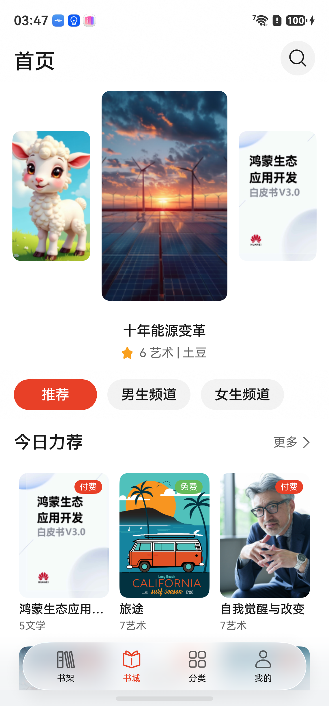 | 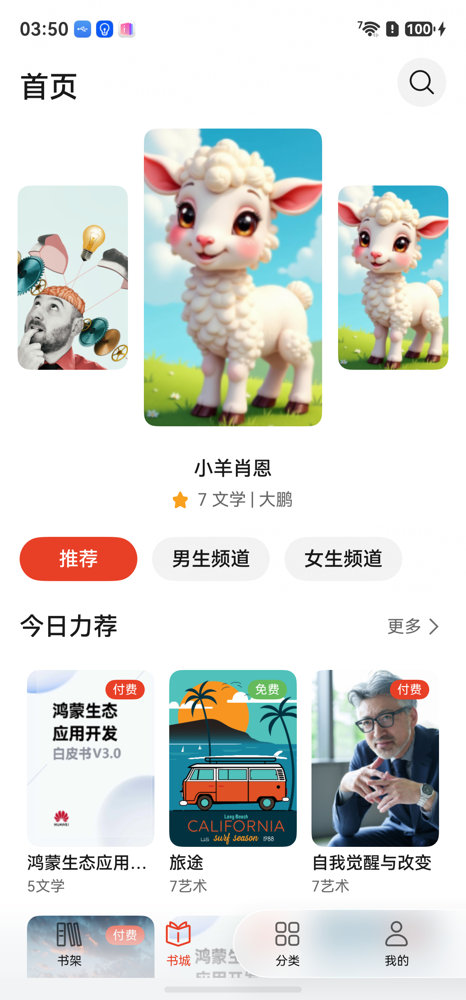 |

**D09-03：HdsTabs.barHeight='auto' 与悬浮材质不兼容**

问题发现日期：2026-09-17。

官网修复状态：未修复；官网 HdsTabs API 于 2026-09-17 复核仍称横向 Tabs 的 `barHeight='auto'` 有效，未注明悬浮样式例外。

状态记录日期：2026-09-17。

验证操作：保持手机横向 HdsTabs、barOverlap 和 barFloatingStyle.systemMaterialEffect 接入，将 HdsTabs.barHeight 设置为 `'auto'`，观察底部四项页签。

文档可得预期：barHeight 说明称 `'auto'` 仅在横向 Tabs 下有效，而本例满足 vertical=false；同一说明还给出悬浮样式默认高度 56vp，但未要求开发者在悬浮模式下删除 auto 或改用数值。因此按文档无法预见材质背板会失效。

真机结果：`HdsTabs_barHeight('auto').png` 中底部四个页签图标和文字仍显示，但完整圆角半透明悬浮背板消失，页签内容直接叠在列表卡片上；沉浸光感接入效果不成立。实测表明悬浮样式下 HdsTabs.barHeight 不能设置为 `'auto'`，应省略该属性以使用 56vp 默认值，或设置经验证的数值高度。

验证状态：**不通过（文档明示横向 auto 有效，却遗漏悬浮样式例外）**。

不通过证据对照：左图为有效数值型 HdsTabs barWidth 下完整的圆角悬浮材质背板；右图设置 `barHeight='auto'` 后，页签内容仍显示，但材质背板消失。

| D09-E03：正常悬浮材质参照 | D09-E04：HdsTabs barHeight='auto' |
| :---: | :---: |
|  |  |

#### 符合性结论

| 结论项 | 结果 | 依据 / 说明 |
|---|---|---|
| 代码实现是否符合开发指南 | 核心接入符合；当前尺寸组合不符合实测约束 | HdsNavigation / HdsTabs、版本、Stage 模型、悬浮四项条件及 ADAPTIVE / ADAPTIVE 均符合；但当前工作树仍保留 HdsTabs `barWidth='100%'` 和 `barHeight='auto'`，会破坏手机悬浮材质，应按真机结论调整。 |
| 真机效果是否符合文档预期 | 1 项通过、2 项不通过 | 有效数值型 HdsTabs barWidth 下基本材质接入通过；`barWidth='100%'` 导致背板错位，`barHeight='auto'` 导致背板消失。 |
| 是否发现疑似文档问题 | 是，1 组已复现的 HdsTabs 尺寸规则缺失 | （1）HdsTabs.barWidth 优先级高于 HdsTabsFloatingStyle.barWidth；（2）悬浮模式的 HdsTabs.barWidth 不能设为百分比 `'100%'`；（3）悬浮模式的 HdsTabs.barHeight 不能设为 `'auto'`。官网分别列出属性却未说明三条组合规则，其中 barHeight 现有表述还会使开发者误以为横向悬浮页签可安全使用 auto。|
| 建议接入方式 | 删除遗留的百分比宽度与 auto 高度 | 手机悬浮分支优先省略 HdsTabs.barWidth / barHeight，使用 HdsTabsFloatingStyle.barWidth 分档值和悬浮默认 56vp；若业务必须控制尺寸，则 HdsTabs.barWidth / barHeight 使用经过真机验证的 vp 数值，并确保与悬浮背板配置一致。 |
| 未覆盖项及结论限制 | 标题栏、平板 / PC / 2in1、深色模式和动态效果未覆盖 | 未验证隐藏标题栏重新显示后的材质、平板侧边页签、各分档断点、旋转 / 折叠状态、温控及页签切换动效；三张截图内容轮播状态不同，但底部页签区域和核心尺寸变量可直接比较。 |

### D10 Express 材质反色、赋色、交互与阴影

#### 基本信息

| 项目 | 内容 |
|---|---|
| Demo 介绍 | 在 Express2 的标题栏和手机端底部悬浮 TabBar 上验证沉浸材质扩展能力：资源色自动反色、20% 红色半透明赋色、按压弹性形变、触摸流光、标题栏右侧圆形材质以及系统材质阴影。 |
| 工程目录 | `Express2/` |
| 页面入口与操作路径 | 启动应用进入 MainEntry 首页；观察顶部标题栏及右侧圆形、底部四项悬浮 TabBar；切换“首页 / 查快递 / 福利 / 我的”，在不同内容背景上观察文字 / 图标可读性和红色材质；按压并滑动触摸页签栏，观察弹性形变与流光。 |
| 代码版本 / 安装包标识 | 以本轮工作树及既有自动报告记录的修改后代码为准；本轮未另行固化提交号或 HAP 哈希。 |
| 验证环境 | HUAWEI Mate XT 2 |
| 工程 SDK / API / HDS 版本 | Stage 模型；targetSdkVersion 26.0.0、compatibleSdkVersion 6.0.0(20)；ArkUI `uiMaterial` API 26 路线，不使用 HDS。 |
| 验证日期 / 验证人 | 2026-09-21 / 验证人待填写 |
| 本次验证范围 | TabBar 的 colorInvert、rgba(255, 0, 0, 0.2) materialColor、interactive、lightEffect、applyShadow；标题栏 ULTRA_THIN 材质、右侧 50×50 圆形材质及其交互 / 阴影；同时核对资源色前提、悬浮三条件和阴影冲突约束。 |

#### 验证点

**D10-01：Tab 自动反色**

前置与操作：TabBar 使用 THIN 材质并设置 `colorInvert: true`；选中文字使用 `$r('sys.color.brand')`，未选文字 / 图标使用系统资源色。在不同内容背景上切换四个页签，观察文字和图标可读性。

文档预期：高 / 中算力设备上，薄材质子树内通过资源接口设置的颜色随材质下方背景自动适配，保持清晰可读；硬编码颜色不属于可反色范围。

核验结果：四项页签文字与图标在内容背景变化及页签切换后均保持清晰，资源色自动适配表现符合预期。

验证状态：**通过**。

**D10-02：Tab 材质赋色 rgba(255, 0, 0, 0.2)**

前置与操作：TabBar 材质设置 `materialColor: 'rgba(255, 0, 0, 0.2)'`，观察悬浮背板的颜色与背景透出。

文档预期：材质在保持滤镜和背景透出的同时叠加 20% 不透明度的红色色调；不应像纯不透明红色一样完全遮挡材质滤镜。

核验结果：底部 TabBar 呈可辨识的半透明红色色调，背景内容仍可透出，材质滤镜没有被纯色遮挡。

验证状态：**通过**。

**D10-03：Tab 按压弹性形变与触摸流光**

前置与操作：TabBar 材质设置 `interactive: true`、`lightEffect: {}`；按压并在页签栏上移动手指，随后松开。

文档预期：按压时产生弹性形变，松手后恢复；触摸时显示默认白色流光跟随。lightEffect 启用后以材质光感反馈替代默认点击 / 悬浮反馈。

核验结果：按压 TabBar 时可观察到弹性形变，松手后正常恢复；手指触摸 / 移动时可观察到流光跟随，页签切换功能正常。

验证状态：**通过**。

**D10-04：标题栏右侧圆形沉浸材质**

前置与操作：标题栏 rightBuilder 内放置 50×50、`borderRadius(25)` 的圆形 Column，设置 ULTRA_THIN 材质、`applyShadow: true`、`interactive: true`；观察圆形外观并按压。

文档预期：右侧节点显示为圆形半透明材质并具有按压形变；圆形位于标题栏区域且不破坏标题布局。

核验结果：标题栏右侧圆形材质可见，尺寸和圆角形态正常，按压反馈生效，标题内容与页面布局未受影响。

验证状态：**通过**。

**D10-05：沉浸材质阴影**

前置与操作：标题栏、标题栏右侧圆形和 TabBar 三处材质均显式设置 `applyShadow: true`，且不额外调用通用 `.shadow()`；分别观察三处材质边缘层次。

文档预期：系统材质阴影生效；避免与通用 shadow 叠加造成优先级冲突和重复绘制。

核验结果：标题栏、右侧圆形及底部 TabBar 均可观察到系统材质阴影和层次感，未出现双重阴影或异常边缘。

验证状态：**通过**。

#### 符合性结论

| 结论项 | 结果 | 依据 / 说明 |
|---|---|---|
| 代码实现是否符合开发指南 | 符合 | [ImmersiveCompat.ets](Express2/products/entry/src/main/ets/utils/ImmersiveCompat.ets) 集中创建标题栏、圆形和 TabBar 材质，参数满足透明赋色、资源色反色、交互、流光及系统材质阴影要求；[MainEntry.ets](Express2/products/entry/src/main/ets/pages/MainEntry.ets) 使用系统资源色、50×50 圆形及手机端悬浮三条件，且未叠加通用 shadow。 |
| 真机效果是否符合文档预期 | 5 / 5 通过 | 自动反色、20% 红色半透明赋色、弹性形变 / 流光、标题栏右侧圆形、三处系统材质阴影均核验通过；既有自动报告的 runtime / visual 结论一致。 |
| 是否发现疑似文档问题 | 未发现新增问题 | 五项表现均与冻结文档描述一致。半透明 materialColor 的通过结果属于 DOC-003 的正向印证，不构成新问题。 |
| 未覆盖项及结论限制 | 缺少跨环境对照 | 未做 colorInvert=false、纯不透明红色、interactive=false、lightEffect=undefined、applyShadow=false 的同条件对照，也未覆盖低算力降级、深色模式、不同强弱档位、温控、大屏侧边页签及 API 20 回退。自动反色和动态轨迹无法由静态文字记录逐帧复核。 |

