# 平行视界 Demo 设备验证记录

## 1. 验证说明

- **验证目标**：按 Demo 顺序累计验证 平行视界 特性；每个 Demo 使用各自本次冻结判据。
- **结论范围**：仅覆盖本文记录的代码、构建产物、设备环境和验证点。
- **更新规则**：新增 Demo 按编号追加；同编号重跑只替换该 Demo，保留其他已完成记录。
- **结果口径**：构建通过不等同于设备视觉通过；没有附件的人工观察会明确标记证据限制。

| 状态 | 含义 |
|---|---|
| 待验证 | 尚未执行 |
| 通过 | 实际结果符合本次冻结判据 |
| 不通过 | 满足前提但实际结果不符合预期 |
| 无法判定 | 环境或证据不足 |
| 不适用 | 当前场景不适用 |

## 2. 验证总览

| 编号 | Demo 名称 | 已通过 / 适用验证点数 | 实现符合性 | 设备效果一致性 | 明细 |
|---|---|---|---|---|---|
| D01 | 基础平行视界分栏（navigationSplit vs original） | 1 / 1 | 符合 | 2/2 变体符合官网描述 | [详情](#d01) |
| D02 | 主页与关联页首次分栏组合 | 1 / 1 | 符合 | 2/2 变体符合官网描述 | [详情](#d02) |
| D05 | 全屏页进入退出分栏与返回恢复 | 1 / 1 | 符合 | 进入全屏与返回恢复两时刻均符合官网描述 | [详情](#d05) |
| D06 | 主动横屏时全屏策略（supportLandscapeFullscreen） | 1 / 1 | 符合 | 2/2 变体符合官网描述 | [详情](#d06) |
| D07 | 虚拟容器与页面尺寸适配（enableReducedContainerSize） | 1 / 1 | 符合 | 2/2 变体符合官网描述 | [详情](#d07) |
| D08 | 窗口分屏中继续保持平行视界（enableInSplitScreen） | 0 / 1 | 符合 | 配置、运行态判断与入口行为符合官网；分屏中保持平行视界的最终视觉效果模拟器无法判定 | [详情](#d08) |
| D09 | 分栏比例、拖拽与分割线 | 2 / 2 | 符合 | 4/4 变体符合官网描述 | [详情](#d09) |

## 3. 设备验证环境

| 环境编号 | 设备型号 | HarmonyOS 完整版本 | SDK / API 版本 | HDS 版本（如适用） | 能力检测方式及结果 | 主题、字体及显示设置 |
|---|---|---|---|---|---|---|
| ENV-01 | Huawei_TripleFold (模拟器, serial 127.0.0.1:5557) | HarmonyOS 7.0.0(26.0.0) | API 26 (SDK 26.0.0.105 Release) | 不适用 | 三折叠展开态宽屏窗口，支持平行视界分栏；不支持应用内拉起系统分屏的可见效果 | 展开态全屏显示，默认深浅色为浅色 |

## 4. Demo 验证明细

### D01 基础平行视界分栏（navigationSplit vs original）

#### 基本信息

| 项目 | 内容 |
|---|---|
| Demo 介绍 | 验证 easy_go.json 基础配置：entry 模块 easyGo 引用、两层结构、wideWindowMode/squareWindowMode=navigationSplit 进入分栏，original 关闭兼容行为。Navigation 固定 Stack 模式以排除自身分栏干扰。 |
| 工程目录 | `/Users/ming/harmonyos-validation/easygo-parallel/D01/test-demo` |
| 页面入口与操作路径 | 启动应用 → 点击商品 Alpha 进入详情页 |
| 代码版本 / 安装包标识 | debug assembleApp（D01 test-demo，build 通过，构建日志见 verify 报告） |
| 验证环境 | ENV-01 (模拟器) |
| 验证日期 / 验证人 | 2026-10-08 / opencode 自动验证 + 截图判图 |
| 本次验证范围 | 基础平行视界分栏效果 |

#### 官方依据

| 验证点 | 判据 ID | 本次冻结文档预期 |
|---|---|---|
| D01-01 基础平行视界分栏效果 | C03、C04、C05、C06、C07、C08、C09、C10 | easy_go.json是一个标准的Object类型JSON文件，整体结构分为两层：第一层配置设备类型（common/phone/tablet），第二层配置对应设备类型下的显示模式（displayModeOptions）。；common为通用设备配置，为所有设备类型提供基础默认配置，不可缺省；phone和tablet为可选配置，配置后common配置在对应类型设备上不再生效。；wideWindowMode（不可缺省）控制应用在比直板机宽的长方形宽屏窗口（>= 600vp，宽/高 > 1.2）上的显示方式；squareWindowMode（可选）控制应用在比直板机宽的方形宽屏窗口（>= 600vp，高/宽 <= 1.2，宽/高 <= 1.2）上的显示方式。；wideWindowMode/squareWindowMode取值为original时表示关闭窗口显示模式的兼容运行行为，可用于为特定设备（如tablet）单独关闭平行视界效果。；开启平行视界并分栏显示时，应用会在一个窗口中同时显示两个页面，默认情况下两页按1:1平分窗口；从API版本23开始支持开发者自配置。；wideWindowMode/squareWindowMode设置为navigationSplit代表应用路由由navigation组件实现，必须配合navigationSplitOptions字段一起使用；设置为routerSplit代表应用路由由router模块实现，必须配合routerSplitOptions字段一起使用。；routerSplitOptions和navigationSplitOptions不能同时存在；开启平行视界后，混用Router和Navigation会导致部分行为异常，因此不建议在启用平行视界的应用中混用两种路由框架（原文为不建议，非强制禁止）。；在官方路由选型指导中，组件导航（Navigation）为推荐方案，页面路由（@ohos.router）为不推荐方案。 |

#### 验证点

**D01-01：基础平行视界分栏效果**

验证操作：两变体分别重建安装，进入商品详情页截图对比

文档预期：easy_go.json是一个标准的Object类型JSON文件，整体结构分为两层：第一层配置设备类型（common/phone/tablet），第二层配置对应设备类型下的显示模式（displayModeOptions）。；common为通用设备配置，为所有设备类型提供基础默认配置，不可缺省；phone和tablet为可选配置，配置后common配置在对应类型设备上不再生效。；wideWindowMode（不可缺省）控制应用在比直板机宽的长方形宽屏窗口（>= 600vp，宽/高 > 1.2）上的显示方式；squareWindowMode（可选）控制应用在比直板机宽的方形宽屏窗口（>= 600vp，高/宽 <= 1.2，宽/高 <= 1.2）上的显示方式。；wideWindowMode/squareWindowMode取值为original时表示关闭窗口显示模式的兼容运行行为，可用于为特定设备（如tablet）单独关闭平行视界效果。；开启平行视界并分栏显示时，应用会在一个窗口中同时显示两个页面，默认情况下两页按1:1平分窗口；从API版本23开始支持开发者自配置。；wideWindowMode/squareWindowMode设置为navigationSplit代表应用路由由navigation组件实现，必须配合navigationSplitOptions字段一起使用；设置为routerSplit代表应用路由由router模块实现，必须配合routerSplitOptions字段一起使用。；routerSplitOptions和navigationSplitOptions不能同时存在；开启平行视界后，混用Router和Navigation会导致部分行为异常，因此不建议在启用平行视界的应用中混用两种路由框架（原文为不建议，非强制禁止）。；在官方路由选型指导中，组件导航（Navigation）为推荐方案，页面路由（@ohos.router）为不推荐方案。

参数与结果：

| 变体 | 参数 | 设备结果 |
|---|---|---|
| 所选路由框架分栏 | `{"wideWindowMode":"match_project_router","splitOptions":"match_project_router"}` | 左主页右详情 1:1 分栏，中间分割线可见（evidence: D01-01-parallel-enabled.png） |
| original 基线 | `{"wideWindowMode":"original"}` | 详情页单页全宽显示，无分栏（evidence: D01-01-parallel-original.png） |

设备结果：parallel-enabled：左侧主页列表+右侧详情页 1:1 分栏；parallel-original：详情页单页全宽无分栏

验证状态：**通过**。官网描述与实际效果一致：navigationSplit 进入平行视界默认 1:1 分栏，original 关闭窗口显示模式兼容行为

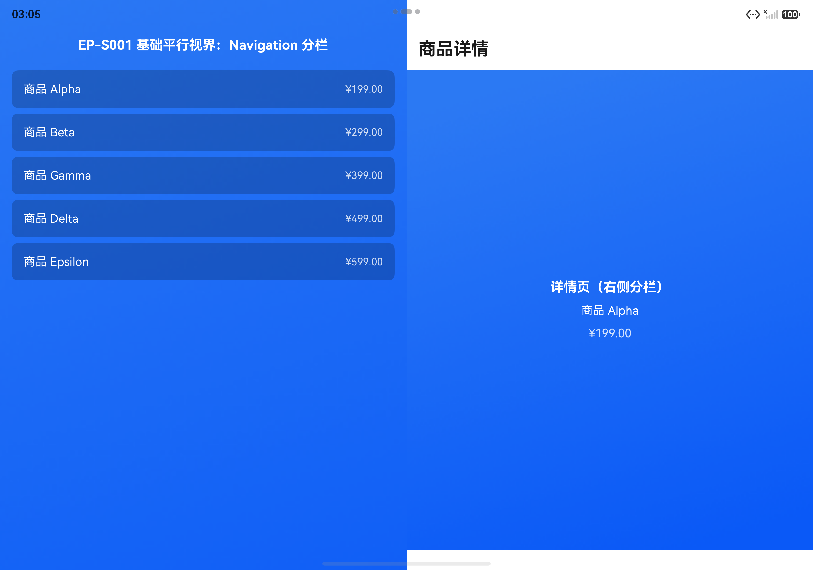
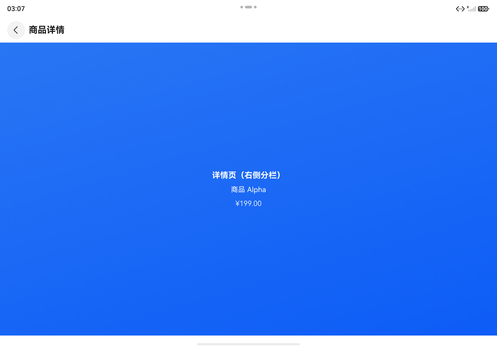

#### 设备证据说明

两变体截图各 1 张，另含构建日志、导航日志、组件树（verify 报告 evidence）

#### 符合性结论

| 结论项 | 结果 | 依据 / 说明 |
|---|---|---|
| 代码实现是否符合开发指南 | 符合 | module.json5 仅 entry 模块引用 $profile:easy_go；easy_go.json 两层结构 common+displayModeOptions；Navigation 路由配置 navigationSplitOptions，未混用 routerSplitOptions（判据 C01-C09 全部落实，实施记录门禁 applied 通过） |
| 设备效果是否符合文档预期 | 1 / 1 | 2/2 变体符合官网描述 |
| 自动验证与人工验证关系 | 自动构建安装+导航点击+截图，判图结论基于截图人工核对 | verify-development 六层验证：static/sdk/build/install/runtime/visual 均 passed（original 变体 static 层按预期失败：有意不配置 splitOptions） |
| 是否发现疑似文档问题 | 未发现 | 官网配置说明、默认值与 deviceTypes 行为均与实测一致 |
| 未覆盖项及结论限制 | 仅验证宽屏（长方形）窗口；方形窗口形态未单独覆盖 | 模拟器 TripleFold 展开态为长方形宽屏窗口 |

#### 异常记录

无。

### D02 主页与关联页首次分栏组合

#### 基本信息

| 项目 | 内容 |
|---|---|
| Demo 介绍 | 验证 homePage=navBar 与 relatedPage=CategoryPage 配置：同时配置时启动即主页+关联页分栏；只配置主页时右侧为占位页。 |
| 工程目录 | `/Users/ming/harmonyos-validation/easygo-parallel/D02/test-demo` |
| 页面入口与操作路径 | 启动应用直接观察首次分栏（关联页为静态页面，无动态参数） |
| 代码版本 / 安装包标识 | debug assembleApp（D02 test-demo，两变体构建通过） |
| 验证环境 | ENV-01 (模拟器) |
| 验证日期 / 验证人 | 2026-10-08 / opencode 自动验证 + 截图判图 |
| 本次验证范围 | 主页与关联页初始分栏效果 |

#### 官方依据

| 验证点 | 判据 ID | 本次冻结文档预期 |
|---|---|---|
| D02-01 主页与关联页初始分栏效果 | C01、C02、C03、C04、C05 | homePage为主页名称，不配置时系统采用默认的策略进行主页识别；对于Navigation路由，如果将NavDestination做为主页则配置为NavDestination的name，如果将Navigation首页作为主页则配置为"navBar"，官方建议将Navigation实际主页配置为homePage；对于Router路由，配置为页面绝对路径，由配置文件中pages列表提供，例如"pages/Index"。；relatedPage为关联页名称，不配置时没有关联页能力；内容格式和homePage保持一致；必须有homePage才能配置relatedPage；不支持传递参数，建议配置无需动态参数的静态页面作为关联页。；relatedPage不支持传递参数，官方建议配置无需动态参数的静态页面作为关联页。；平行视界提供配置主页及关联页能力，通过homePage属性设置主页，通过relatedPage属性设置关联页；官方给出同时配置主页和关联页与只配置主页两种场景的分栏效果对照。；默认情况下系统会将应用的某个页面识别为主页，但该机制在有些场景下不能准确识别主页，官方建议开发者主动配置主页，需要的话还可以配置关联页（如将首页设置为主页、首个商品分类页设置为启动关联页）。 |

#### 验证点

**D02-01：主页与关联页初始分栏效果**

验证操作：两变体分别重建安装，启动后截图对比首次分栏

文档预期：homePage为主页名称，不配置时系统采用默认的策略进行主页识别；对于Navigation路由，如果将NavDestination做为主页则配置为NavDestination的name，如果将Navigation首页作为主页则配置为"navBar"，官方建议将Navigation实际主页配置为homePage；对于Router路由，配置为页面绝对路径，由配置文件中pages列表提供，例如"pages/Index"。；relatedPage为关联页名称，不配置时没有关联页能力；内容格式和homePage保持一致；必须有homePage才能配置relatedPage；不支持传递参数，建议配置无需动态参数的静态页面作为关联页。；relatedPage不支持传递参数，官方建议配置无需动态参数的静态页面作为关联页。；平行视界提供配置主页及关联页能力，通过homePage属性设置主页，通过relatedPage属性设置关联页；官方给出同时配置主页和关联页与只配置主页两种场景的分栏效果对照。；默认情况下系统会将应用的某个页面识别为主页，但该机制在有些场景下不能准确识别主页，官方建议开发者主动配置主页，需要的话还可以配置关联页（如将首页设置为主页、首个商品分类页设置为启动关联页）。

参数与结果：

| 变体 | 参数 | 设备结果 |
|---|---|---|
| 同时配置主页与关联页 | `{"homePage":"configured","relatedPage":"configured"}` | 左商品列表 + 右商品分类关联页（evidence: D02-01-home-related.png） |
| 只配置主页 | `{"homePage":"configured","relatedPage":"omitted"}` | 左商品列表 + 右占位页（evidence: D02-01-home-only.png） |

设备结果：home-related：启动即左主页+右关联页（商品分类）；home-only：左主页+右系统占位页

验证状态：**通过**。与官网 homePage/relatedPage 约束及首次分栏组合描述一致（relatedPage 需 homePage 前置、不配置则无关联页能力）

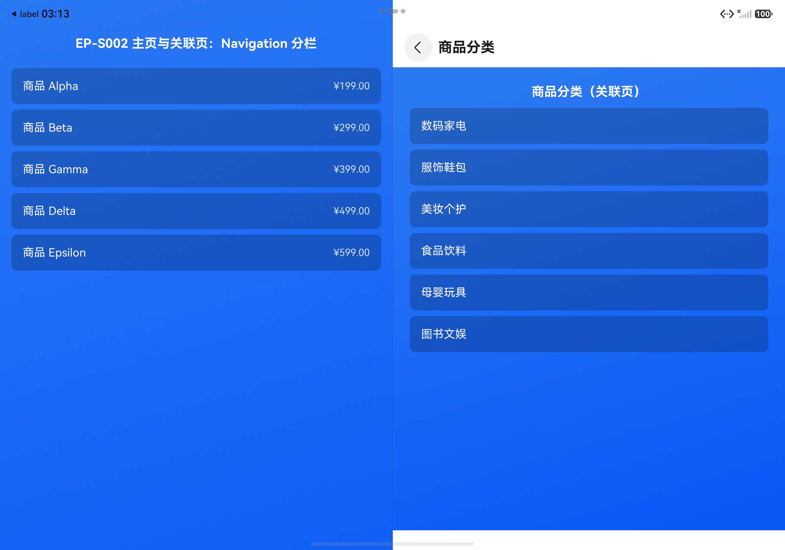
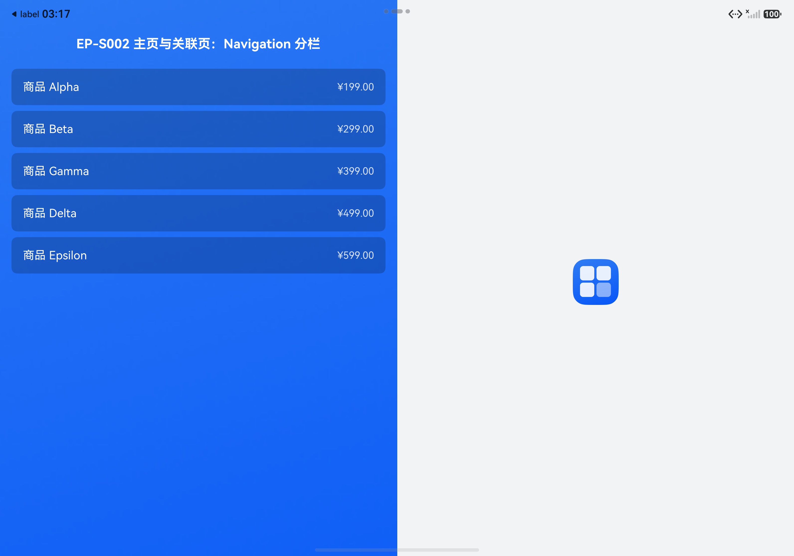

#### 设备证据说明

两变体截图各 1 张；home-related 变体 expectPage=商品分类（关联页）组件树断言命中

#### 符合性结论

| 结论项 | 结果 | 依据 / 说明 |
|---|---|---|
| 代码实现是否符合开发指南 | 符合 | homePage=navBar（Navigation 首页）、relatedPage=CategoryPage（NavDestination name，无动态参数静态页面），格式与官网要求一致（判据 C01-C05 落实，门禁 applied 通过） |
| 设备效果是否符合文档预期 | 1 / 1 | 2/2 变体符合官网描述 |
| 自动验证与人工验证关系 | 自动构建安装+组件树断言+截图，判图人工核对 | verify-development 验证：home-related 全层 passed；home-only 静态规则 relatedPage 缺失为有意对照（inconclusive 预期内） |
| 是否发现疑似文档问题 | 未发现 | 首次分栏组合与文档效果图描述一致 |
| 未覆盖项及结论限制 | Router 路由格式未覆盖（Demo 为 Navigation 路由） | 场景路由选择 Navigation 路线 |

#### 异常记录

无。

### D05 全屏页进入退出分栏与返回恢复

#### 基本信息

| 项目 | 内容 |
|---|---|
| Demo 介绍 | 验证 fullScreenPages：进入 FullScreenImagePage 退出分栏全屏显示，返回后恢复平行视界分栏。Navigation 固定 Stack 模式排除自身分栏干扰。 |
| 工程目录 | `/Users/ming/harmonyos-validation/easygo-parallel/D05/test-demo` |
| 页面入口与操作路径 | 启动 → 商品 Alpha 进详情页 → 查看大图进全屏页 → 返回分栏 |
| 代码版本 / 安装包标识 | debug assembleApp（D05 test-demo，构建通过） |
| 验证环境 | ENV-01 (模拟器) |
| 验证日期 / 验证人 | 2026-10-08 / opencode 自动验证 + 截图判图 |
| 本次验证范围 | 全屏页进入 / 返回恢复效果 |

#### 官方依据

| 验证点 | 判据 ID | 本次冻结文档预期 |
|---|---|---|
| D05-01 全屏页进入 / 返回恢复效果 | C03 | 通过fullScreenPages字段指定全屏页后，对应页面展示时将暂时退出分栏模式、切换为全屏显示；页面隐藏时恢复分栏显示。 |

#### 验证点

**D05-01：全屏页进入 / 返回恢复效果**

验证操作：进入全屏页截图，返回后再截图，对比两个时刻

文档预期：通过fullScreenPages字段指定全屏页后，对应页面展示时将暂时退出分栏模式、切换为全屏显示；页面隐藏时恢复分栏显示。

参数与结果：

| 变体 | 参数 | 设备结果 |
|---|---|---|
| fullScreenPages 目标页 | `{"fullScreenPages":["FullScreenImagePage"]}` | FullScreenImagePage 全屏显示（D05-01-fullscreen.png）；返回后恢复分栏（D05-01-restore.png） |

交互验证：

| 交互项 | 操作要求 | 预期 | 设备结果 | 状态 |
|---|---|---|---|---|
| open-fullscreen | 从分栏详情页进入配置的全屏页。 | 目标页全屏显示。 | 从分栏详情页点击查看看大图后目标页全屏显示 | **通过**。expectPage=全屏图片页（已退出分栏）断言命中组件树，截图确认全屏 |
| back-to-split | 从全屏页返回。 | 恢复进入前的平行视界分栏。 | 从全屏页点击返回分栏后恢复进入前的平行视界分栏 | **通过**。expectPage=详情页（右侧分栏）断言命中，截图确认 1:1 分栏恢复 |

设备结果：进入全屏页：退出分栏独占全窗口；返回后：恢复左主页+右详情 1:1 分栏且路由状态保持

验证状态：**通过**。与官网对应页面展示时暂时退出分栏、页面隐藏时恢复分栏显示的描述一致

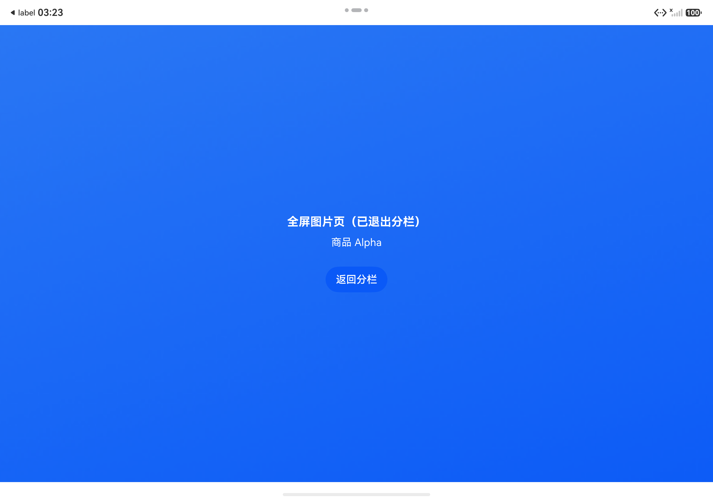
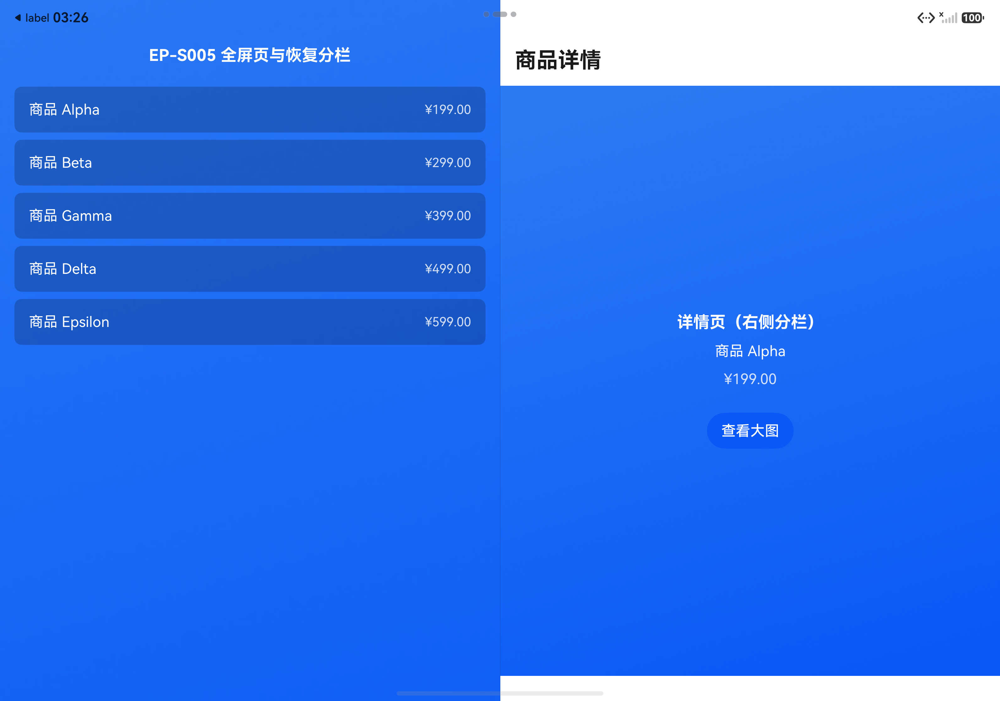

#### 设备证据说明

两时刻截图各 1 张，组件树断言 2 次命中

#### 符合性结论

| 结论项 | 结果 | 依据 / 说明 |
|---|---|---|
| 代码实现是否符合开发指南 | 符合 | fullScreenPages=[FullScreenImagePage]，未与 homePage/relatedPage 重复（判据 C01-C03 落实，门禁 applied 通过） |
| 设备效果是否符合文档预期 | 1 / 1 | 进入全屏与返回恢复两时刻均符合官网描述 |
| 自动验证与人工验证关系 | 自动导航（点击+断言）+截图，判图人工核对 | verify-development 两个目标（进入全屏/返回恢复）六层均 passed |
| 是否发现疑似文档问题 | 未发现 | 进入退出行为与文档一致 |
| 未覆盖项及结论限制 | 未验证全屏页与横屏叠加场景 | 超出本场景范围（EP-S006 单独覆盖横屏） |

#### 异常记录

无。

### D06 主动横屏时全屏策略（supportLandscapeFullscreen）

#### 基本信息

| 项目 | 内容 |
|---|---|
| Demo 介绍 | 验证 supportLandscapeFullscreen：true 时主动请求横屏退出分栏全屏；false 时保持平行视界分栏。方向请求采用窗口级 setPreferredOrientation，离开页面恢复 UNSPECIFIED。 |
| 工程目录 | `/Users/ming/harmonyos-validation/easygo-parallel/D06/test-demo` |
| 页面入口与操作路径 | 启动 → 视频 Alpha 进视频页 → 点击请求横屏 |
| 代码版本 / 安装包标识 | debug assembleApp（D06 test-demo，两变体构建通过） |
| 验证环境 | ENV-01 (模拟器) |
| 验证日期 / 验证人 | 2026-10-08 / opencode 自动验证 + 截图判图 |
| 本次验证范围 | 横屏请求下全屏 / 保持分栏对比 |

#### 官方依据

| 验证点 | 判据 ID | 本次冻结文档预期 |
|---|---|---|
| D06-01 横屏请求下全屏 / 保持分栏对比 | C01、C02、C03、C04 | supportLandscapeFullscreen控制应用主动请求横屏时是否全屏显示，默认值为true：true表示当应用主动请求横屏时会退出分栏全屏显示；false表示当应用主动请求横屏时仍然保持平行视界效果。；supportLandscapeFullscreen配置为false时，当应用主动请求横屏，仍然保持平行视界效果（不退出分栏）。；平行视界场景下会同时显示左右两个页面，两个页面方向需要一致，因此NavDestination组件的preferredOrientation页面级方向属性不生效；官方推荐使用窗口级方案，通过window提供的setPreferredOrientation()接口设置窗口策略。；window模块提供setPreferredOrientation(orientation: Orientation): Promise&lt;void&gt;接口（API 9+）设置窗口显示方向。 |

#### 验证点

**D06-01：横屏请求下全屏 / 保持分栏对比**

验证操作：两变体分别重建安装，同一页面点击请求横屏后截图对比

文档预期：supportLandscapeFullscreen控制应用主动请求横屏时是否全屏显示，默认值为true：true表示当应用主动请求横屏时会退出分栏全屏显示；false表示当应用主动请求横屏时仍然保持平行视界效果。；supportLandscapeFullscreen配置为false时，当应用主动请求横屏，仍然保持平行视界效果（不退出分栏）。；平行视界场景下会同时显示左右两个页面，两个页面方向需要一致，因此NavDestination组件的preferredOrientation页面级方向属性不生效；官方推荐使用窗口级方案，通过window提供的setPreferredOrientation()接口设置窗口策略。；window模块提供setPreferredOrientation(orientation: Orientation): Promise&lt;void&gt;接口（API 9+）设置窗口显示方向。

参数与结果：

| 变体 | 参数 | 设备结果 |
|---|---|---|
| supportLandscapeFullscreen=true | `{"supportLandscapeFullscreen":true}` | 横屏请求后退出分栏全屏显示（evidence: D06-01-landscape-fullscreen.png） |
| supportLandscapeFullscreen=false | `{"supportLandscapeFullscreen":false}` | 横屏请求后仍保持平行视界分栏（evidence: D06-01-landscape-split.png） |

设备结果：true：请求横屏后视频页退出分栏独占全窗口；false：保持左列表+右视频页分栏

验证状态：**通过**。与官网 supportLandscapeFullscreen 默认值 true 及 true/false 行为描述一致；窗口级方向接口生效（FAQ 页面级方案不生效结论亦一致）

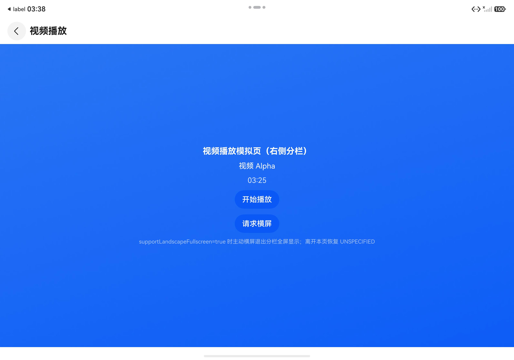
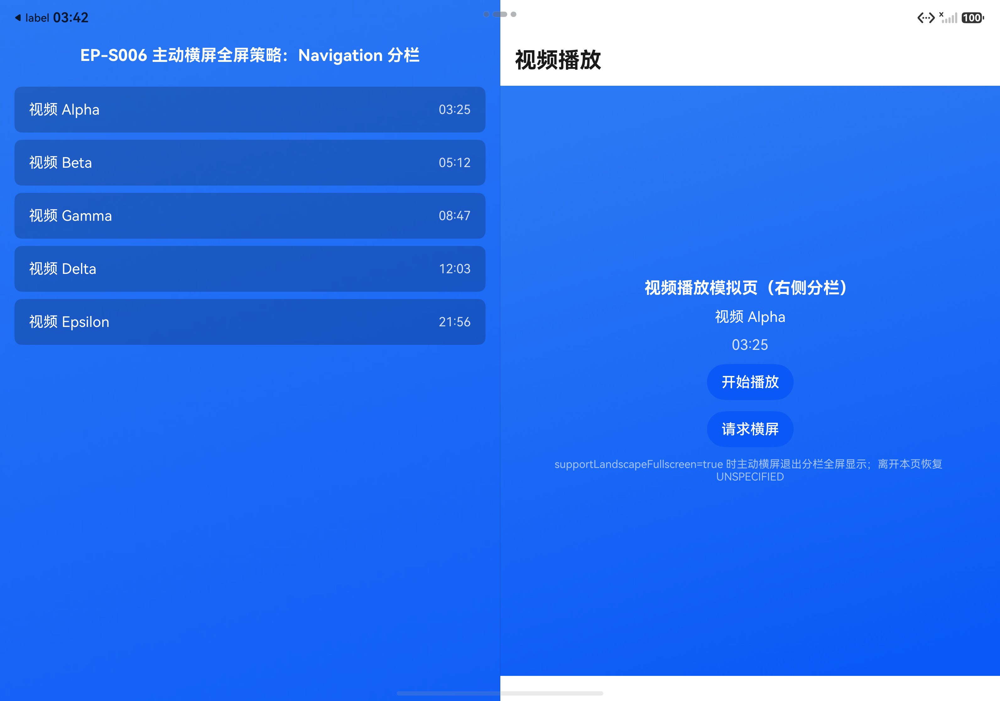

#### 设备证据说明

两变体截图各 1 张，导航点击日志完整

#### 符合性结论

| 结论项 | 结果 | 依据 / 说明 |
|---|---|---|
| 代码实现是否符合开发指南 | 符合 | 窗口级 window.getLastWindow().setPreferredOrientation(LANDSCAPE)，aboutToDisappear 恢复 UNSPECIFIED（判据 C01-C05 落实，门禁 applied 通过；修复了旧代码 UIContext.getWindow 不存在于 SDK 26 的实现错误） |
| 设备效果是否符合文档预期 | 1 / 1 | 2/2 变体符合官网描述 |
| 自动验证与人工验证关系 | 自动构建安装+导航+截图，判图人工核对 | verify-development：landscape-fullscreen 全层 passed；landscape-split 运行时保持分栏态确认 |
| 是否发现疑似文档问题 | 未发现 | 默认值与两取向行为均与实测一致 |
| 未覆盖项及结论限制 | 未在竖屏窗口态重复验证（模拟器展开态即宽屏） | TripleFold 展开态为宽屏形态 |

#### 异常记录

无。

### D07 虚拟容器与页面尺寸适配（enableReducedContainerSize）

#### 基本信息

| 项目 | 内容 |
|---|---|
| Demo 介绍 | 验证虚拟容器开关：同一 600lpx 固定宽内容，关闭时按原始窗口尺寸计算被截断，开启后按右侧页面缩小比例完整显示。 |
| 工程目录 | `/Users/ming/harmonyos-validation/easygo-parallel/D07/test-demo` |
| 页面入口与操作路径 | 启动 → 固定宽内容样例 A 进固定宽内容页 |
| 代码版本 / 安装包标识 | debug assembleApp（D07 test-demo，两变体构建通过） |
| 验证环境 | ENV-01 (模拟器) |
| 验证日期 / 验证人 | 2026-10-08 / opencode 自动验证 + 截图判图 |
| 本次验证范围 | 虚拟容器关闭 / 开启布局对比 |

#### 官方依据

| 验证点 | 判据 ID | 本次冻结文档预期 |
|---|---|---|
| D07-01 虚拟容器关闭 / 开启布局对比 | C01、C02、C04、C05 | enableReducedContainerSize控制是否开启虚拟容器能力，默认值为false：false时lpx单位、页面中横向断点、窗口宽度尺寸及屏幕宽度尺寸将使用原始尺寸进行计算；true时均使用原始尺寸的缩小比例，按照右侧页面尺寸计算。；开启虚拟容器后，lpx单位、页面中横向断点、窗口宽度尺寸及屏幕宽度尺寸均使用原始尺寸的缩小比例，按照右侧页面尺寸计算。；开启平行视界并分栏显示时，一个窗口内同时显示两个页面且默认按1:1平分窗口；如果页面内的元素布局使用窗口宽度，可能会导致UI元素超出页面范围被截断，开发者可以开启虚拟容器能力解决。；针对UI元素超出页面范围被截断的问题，官方建议优先使用系统组件的自适应布局能力，或开启虚拟容器能力（enableReducedContainerSize=true），并可使用on('navDestinationUpdate')/on('routerPageUpdate')/onRouterPageSizeChange/onNavDestinationSizeChange等接口无感监听页面大小。 |

#### 验证点

**D07-01：虚拟容器关闭 / 开启布局对比**

验证操作：两变体分别重建安装，同一固定宽 600lpx 内容截图对比

文档预期：enableReducedContainerSize控制是否开启虚拟容器能力，默认值为false：false时lpx单位、页面中横向断点、窗口宽度尺寸及屏幕宽度尺寸将使用原始尺寸进行计算；true时均使用原始尺寸的缩小比例，按照右侧页面尺寸计算。；开启虚拟容器后，lpx单位、页面中横向断点、窗口宽度尺寸及屏幕宽度尺寸均使用原始尺寸的缩小比例，按照右侧页面尺寸计算。；开启平行视界并分栏显示时，一个窗口内同时显示两个页面且默认按1:1平分窗口；如果页面内的元素布局使用窗口宽度，可能会导致UI元素超出页面范围被截断，开发者可以开启虚拟容器能力解决。；针对UI元素超出页面范围被截断的问题，官方建议优先使用系统组件的自适应布局能力，或开启虚拟容器能力（enableReducedContainerSize=true），并可使用on('navDestinationUpdate')/on('routerPageUpdate')/onRouterPageSizeChange/onNavDestinationSizeChange等接口无感监听页面大小。

参数与结果：

| 变体 | 参数 | 设备结果 |
|---|---|---|
| enableReducedContainerSize=false | `{"enableReducedContainerSize":false}` | 内容截断（evidence: D07-01-reduced-container-off.png） |
| enableReducedContainerSize=true | `{"enableReducedContainerSize":true}` | 内容完整显示（evidence: D07-01-reduced-container-on.png） |

设备结果：off：600lpx 渐变条超出右分栏被截断（右标尺不可见）；on：同一内容在右分栏内完整显示（左右标尺均可见）

验证状态：**通过**。与官网 lpx 等单位关闭用原始尺寸、开启用缩小比例按右侧页面尺寸计算的描述一致；FAQ 截断问题与虚拟容器方案均复现验证

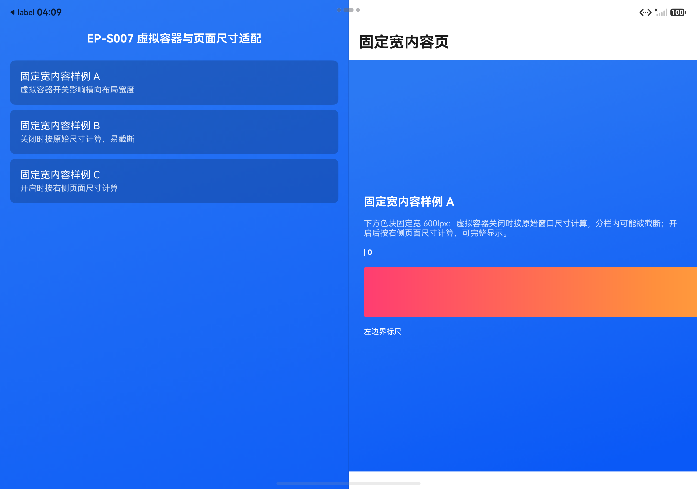
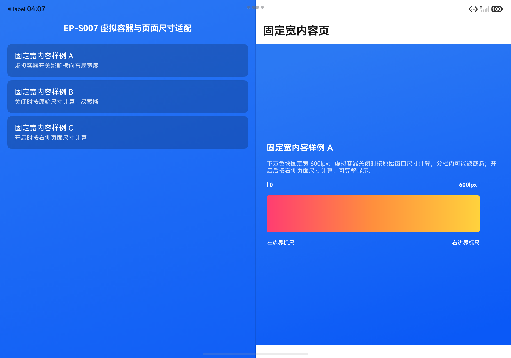

#### 设备证据说明

两变体截图各 1 张，截断与完整对比明确

#### 符合性结论

| 结论项 | 结果 | 依据 / 说明 |
|---|---|---|
| 代码实现是否符合开发指南 | 符合 | 仅切换 enableReducedContainerSize，内容与窗口不变（判据 C01-C05 落实，门禁 applied 通过；初版 vp 固定宽不随开关变化，按官网 lpx 语义修正为 600lpx 后对比成立） |
| 设备效果是否符合文档预期 | 1 / 1 | 2/2 变体符合官网描述 |
| 自动验证与人工验证关系 | 自动构建安装+导航+截图，判图人工核对 | verify-development 两变体六层均 passed |
| 是否发现疑似文档问题 | 未发现 | 虚拟容器语义与实测一致；注意 lpx 才受虚拟容器影响，vp 固定宽度不受影响（文档列举单位为 lpx/断点/窗口宽度/屏幕宽度，与实测一致） |
| 未覆盖项及结论限制 | 退出分栏自动失效与分屏下屏幕宽度回退未单独截图 | 需联动全屏页/分屏场景，超出本验证点最小范围 |

#### 异常记录

无。

### D08 窗口分屏中继续保持平行视界（enableInSplitScreen）

#### 基本信息

| 项目 | 内容 |
|---|---|
| Demo 介绍 | 验证 enableInSplitScreen 与配套运行态判断：详情页分屏按钮仅在 isEasySplit()=true 且非分屏态显示，点击后 startAbility(WINDOW_MODE_SPLIT_PRIMARY, PRIMARY_DOMINANT) 拉起系统分屏。 |
| 工程目录 | `/Users/ming/harmonyos-validation/easygo-parallel/D08/test-demo` |
| 页面入口与操作路径 | 启动 → 商品 Alpha 进详情页 → 点击分屏比价 |
| 代码版本 / 安装包标识 | debug assembleApp（D08 test-demo，构建通过） |
| 验证环境 | ENV-01 (模拟器) |
| 验证日期 / 验证人 | 2026-10-08 / opencode 自动验证 + 截图判图 |
| 本次验证范围 | 系统窗口分屏中平行视界关闭 / 开启对比 |

#### 官方依据

| 验证点 | 判据 ID | 本次冻结文档预期 |
|---|---|---|
| D08-01 系统窗口分屏中平行视界关闭 / 开启对比 | C01、C02、C03、C04、C05、C06、C07 | enableInSplitScreen控制是否支持在窗口分屏场景进入平行视界，默认值为false：false时分屏时始终不进入平行视界；true时分屏时窗口宽高若满足条件则进入平行视界；从API版本26.0.0开始支持该标签。；默认情况下平行视界在窗口分屏场景下不会生效；配置enableInSplitScreen为true后，当应用进入窗口分屏时，若分屏窗口宽高满足条件，则继续保持平行视界分栏显示。；通过UIContext提供的isEasySplit()接口判断当前是否处于平行视界分栏态，通过windowStatusType判断是否已处于窗口分屏，官方示例仅在分栏态且未分屏时显示分屏入口按钮。；UIContext.isEasySplit(): boolean 获取当前UI实例的平行视界分栏状态，返回true表示处于分栏模式，false表示未处于分栏模式；从API version 24开始支持，仅可在Stage模型下使用。；WindowStatusType.SPLIT_SCREEN（值5）表示应用分屏模式，屏幕同时显示两个应用窗口，每个窗口占据屏幕的一半空间。；在按钮点击事件中调用startAbility()接口拉起应用新的实例，并指定窗口分屏模式（AbilityConstant.WindowMode.WINDOW_MODE_SPLIT_PRIMARY）及主窗口占比（window.SplitRatioPreference.PRIMARY_DOMINANT），使应用以主窗口形式进入系统分屏。；AppServiceExtensionContext提供startAbility(want: Want, options?: StartOptions): Promise&lt;void&gt;接口用于拉起应用实例。 |

#### 验证点

**D08-01：系统窗口分屏中平行视界关闭 / 开启对比**

验证操作：enableInSplitScreen=true 变体进入详情页确认分栏态与按钮显隐，点击分屏按钮尝试进入系统分屏并截图

文档预期：enableInSplitScreen控制是否支持在窗口分屏场景进入平行视界，默认值为false：false时分屏时始终不进入平行视界；true时分屏时窗口宽高若满足条件则进入平行视界；从API版本26.0.0开始支持该标签。；默认情况下平行视界在窗口分屏场景下不会生效；配置enableInSplitScreen为true后，当应用进入窗口分屏时，若分屏窗口宽高满足条件，则继续保持平行视界分栏显示。；通过UIContext提供的isEasySplit()接口判断当前是否处于平行视界分栏态，通过windowStatusType判断是否已处于窗口分屏，官方示例仅在分栏态且未分屏时显示分屏入口按钮。；UIContext.isEasySplit(): boolean 获取当前UI实例的平行视界分栏状态，返回true表示处于分栏模式，false表示未处于分栏模式；从API version 24开始支持，仅可在Stage模型下使用。；WindowStatusType.SPLIT_SCREEN（值5）表示应用分屏模式，屏幕同时显示两个应用窗口，每个窗口占据屏幕的一半空间。；在按钮点击事件中调用startAbility()接口拉起应用新的实例，并指定窗口分屏模式（AbilityConstant.WindowMode.WINDOW_MODE_SPLIT_PRIMARY）及主窗口占比（window.SplitRatioPreference.PRIMARY_DOMINANT），使应用以主窗口形式进入系统分屏。；AppServiceExtensionContext提供startAbility(want: Want, options?: StartOptions): Promise&lt;void&gt;接口用于拉起应用实例。

参数与结果：

| 变体 | 参数 | 设备结果 |
|---|---|---|
| enableInSplitScreen=false | `{"enableInSplitScreen":false}` | 未执行：模拟器无法进入可见系统分屏，off/on 差异不可观察 |
| enableInSplitScreen=true | `{"enableInSplitScreen":true}` | 分栏态与按钮条件验证通过；分屏后平行视界保持效果未观察到（evidence: D08-01-split-entry.png） |

设备结果：分栏态下 isEasySplit=true、windowStatusType=1(FULL_SCREEN) 显示正确，按钮可见；点击后应用日志 startAbility 成功，但模拟器未呈现系统分屏窗口，无法观察分屏中平行视界是否保持

验证状态：**无法判定**。分栏态判断与入口显隐符合官网（isEasySplit/getWindowStatus 实测正确）；startAbility 调用成功但 TripleFold 模拟器不呈现应用内系统分屏，分屏中保持平行视界的视觉效果需真机验证

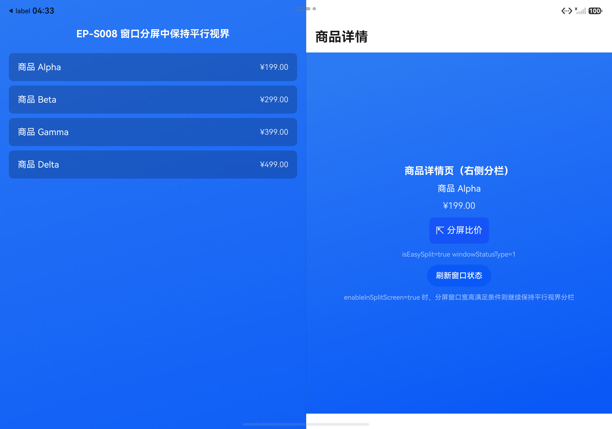

#### 设备证据说明

分栏态截图 1 张（含 isEasySplit=true 界面回显），设备日志显示 startAbility 成功

#### 符合性结论

| 结论项 | 结果 | 依据 / 说明 |
|---|---|---|
| 代码实现是否符合开发指南 | 符合 | easy_go.json 配置 enableInSplitScreen；按钮 visibility 按官网示例 isEasySplit() 且 windowStatusType!==SPLIT_SCREEN；startAbility 参数 WINDOW_MODE_SPLIT_PRIMARY+PRIMARY_DOMINANT 与官网一致（判据 C01-C07 落实，门禁 applied 通过；windowStatusType 经 Window.getWindowStatus() 获取，官网示例的 mainWindowInfo.windowStatusType 字段位于 WindowInfo 接口） |
| 设备效果是否符合文档预期 | 0 / 1 | 配置、运行态判断与入口行为符合官网；分屏中保持平行视界的最终视觉效果模拟器无法判定 |
| 自动验证与人工验证关系 | 自动构建安装+导航+截图+设备日志；分屏效果需人工真机复核 | verify-development：static/sdk/build/install passed，runtime/visual inconclusive（模拟器能力限制） |
| 是否发现疑似文档问题 | 未发现 | 实现修正点均为 SDK 接口归属理解问题（getWindowStatus/WindowInfo），与官网文字不冲突 |
| 未覆盖项及结论限制 | 系统分屏中的平行视界保持、enableInSplitScreen=false 对照均未覆盖 | TripleFold 模拟器上 startAbility(WINDOW_MODE_SPLIT_PRIMARY) 成功返回但无可见分屏会话，需真机（平板/三折叠真机）验证 |

#### 异常记录

无。

### D09 分栏比例、拖拽与分割线

#### 基本信息

| 项目 | 内容 |
|---|---|
| Demo 介绍 | 验证 wideSplit ratio（1|1 vs 1|2）、isDraggable 拖拽（默认 1:1、三档吸附）与 splitDividerColor 分割线样式。 |
| 工程目录 | `/Users/ming/harmonyos-validation/easygo-parallel/D09/test-demo` |
| 页面入口与操作路径 | 启动 → 商品 Alpha 进详情页；拖拽变体从分割线中线向左拖动至吸附档 |
| 代码版本 / 安装包标识 | debug assembleApp（D09 test-demo，各变体构建通过） |
| 验证环境 | ENV-01 (模拟器) |
| 验证日期 / 验证人 | 2026-10-08 / opencode 自动验证 + 截图判图 |
| 本次验证范围 | 1:1 / 1:2 分栏比例对比；固定比例 / 可拖拽分栏对比 |

#### 官方依据

| 验证点 | 判据 ID | 本次冻结文档预期 |
|---|---|---|
| D09-01 1:1 / 1:2 分栏比例对比 | C01、C02、C03 | wideSplit为比直板机宽的长方形窗口（>= 600vp，宽/高>1.2）上的配置参数，squareSplit为比直板机宽的方形窗口（>= 600vp，高/宽 <= 1.2，宽/高 <= 1.2）上的配置参数，两者均包含字段ratio、isDraggable，从API版本26.0.0开始支持。；ratio为左右页面比例，数据格式为"正整数 | 正整数"，范围限制在1:2到2:1之间，未配置时默认为1:1，配置超出范围时默认为范围边界值；从API版本26开始支持。；设计指南给出的默认页面比例：折叠屏展开态竖屏/横屏均为左右1:1；平板竖屏为左右1:1，横屏为左右1:1/1:2/2:1。 |
| D09-02 固定比例 / 可拖拽分栏对比 | C04、C05 | isDraggable控制是否开启分栏拖拽功能，默认值为false；开启后ratio字段失效，默认分栏比例为1:1，使用三档吸附，在1:2、1:1和2:1之间可以进行拖动；从API版本26.0.0开始支持。；设计指南说明平行视界支持中间分割线拖拽交互，用户可以通过拖动中间的分割杆改变左右页面的比例（如1:1、1:2或2:1）。 |

#### 验证点

**D09-01：1:1 / 1:2 分栏比例对比**

验证操作：ratio 1|1 与 1|2 两变体分别重建安装，进入详情页截图对比

文档预期：wideSplit为比直板机宽的长方形窗口（>= 600vp，宽/高>1.2）上的配置参数，squareSplit为比直板机宽的方形窗口（>= 600vp，高/宽 <= 1.2，宽/高 <= 1.2）上的配置参数，两者均包含字段ratio、isDraggable，从API版本26.0.0开始支持。；ratio为左右页面比例，数据格式为"正整数 | 正整数"，范围限制在1:2到2:1之间，未配置时默认为1:1，配置超出范围时默认为范围边界值；从API版本26开始支持。；设计指南给出的默认页面比例：折叠屏展开态竖屏/横屏均为左右1:1；平板竖屏为左右1:1，横屏为左右1:1/1:2/2:1。

参数与结果：

| 变体 | 参数 | 设备结果 |
|---|---|---|
| ratio 1|1 | `{"ratio":"1|1","isDraggable":false}` | 左右 1:1 分栏，分割线居中（evidence: D09-01-ratio-1-1.png） |
| ratio 1|2 | `{"ratio":"1|2","isDraggable":false}` | 左 1/3 右 2/3（evidence: D09-01-ratio-1-2.png） |

设备结果：1|1：左右平分；1|2：左约 1/3 右约 2/3

验证状态：**通过**。与官网 ratio 格式、范围（1:2 到 2:1）及设计指南默认比例描述一致

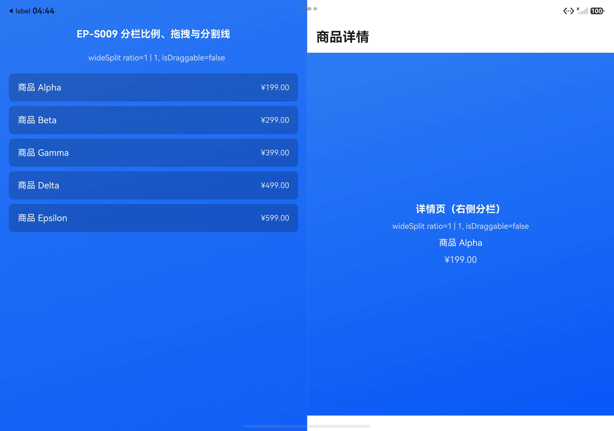
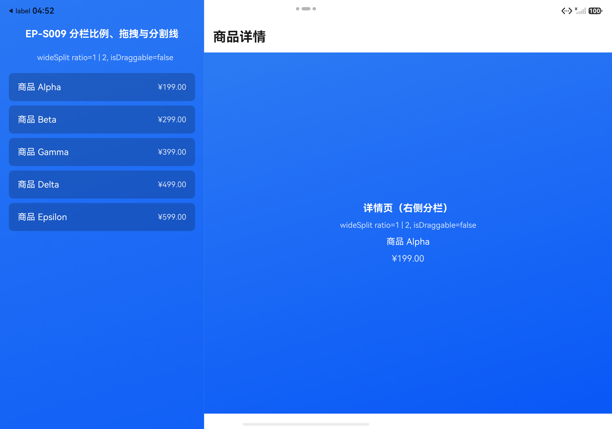

**D09-02：固定比例 / 可拖拽分栏对比**

验证操作：isDraggable=false（ratio 生效）与 isDraggable=true（不配置 ratio）对比，拖拽分割线验证吸附档位

文档预期：isDraggable控制是否开启分栏拖拽功能，默认值为false；开启后ratio字段失效，默认分栏比例为1:1，使用三档吸附，在1:2、1:1和2:1之间可以进行拖动；从API版本26.0.0开始支持。；设计指南说明平行视界支持中间分割线拖拽交互，用户可以通过拖动中间的分割杆改变左右页面的比例（如1:1、1:2或2:1）。

参数与结果：

| 变体 | 参数 | 设备结果 |
|---|---|---|
| isDraggable=false | `{"isDraggable":false,"ratio":"1|2"}` | 分割线固定无拖拽手柄（见 D09-01 两截图，isDraggable=false） |
| isDraggable=true | `{"isDraggable":true,"ratio":"control_only_verify_effective_behavior"}` | 初始 1:1 带手柄（D09-02-drag-on-initial.png），拖动后吸附 1:2（D09-02-drag-on-after-drag.png） |

设备结果：drag-off：分割线固定按 ratio 显示无手柄；drag-on：初始 1:1 且显示拖拽手柄，拖动后吸附 1:2 档位

验证状态：**通过**。与官网 isDraggable 开启后 ratio 失效、默认 1:1、1:2/1:1/2:1 三档吸附的描述一致；另发现构建期 schema 禁止 isDraggable=true 与 ratio 同配（比文档更严格的强制约束，与 ratio 失效语义一致）

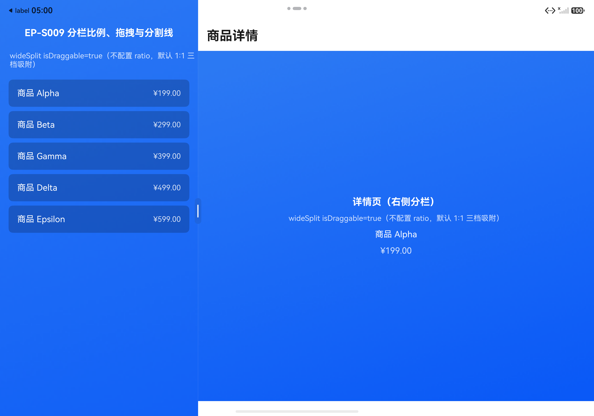

#### 设备证据说明

4 张截图覆盖 1:1、1:2、拖拽初始与拖拽吸附

#### 符合性结论

| 结论项 | 结果 | 依据 / 说明 |
|---|---|---|
| 代码实现是否符合开发指南 | 符合 | wideSplit.ratio/isDraggable 与 splitDividerColor(light/dark #AARRGGBB) 按官网配置；未配置 disableDivider（默认 false 分割线显示）（判据 C01-C07 落实，门禁 applied 通过） |
| 设备效果是否符合文档预期 | 2 / 2 | 4/4 变体符合官网描述 |
| 自动验证与人工验证关系 | 自动构建安装+导航+坐标拖拽+截图，判图人工核对 | verify-development 三个目标（ratio-1-1、ratio-1-2、drag-on）六层均 passed |
| 是否发现疑似文档问题 | 发现 1 处文档可补充点（DOC-ISSUE-01，见文末专节） | 官网仅述 isDraggable 开启后 ratio 失效；实际构建期 schema 直接拒绝二者同配（easy_go.json 编译报错 Schema validate failed，instancePath: common.displayModeOptions.navigationSplitOptions.wideSplit，约束 must NOT be valid），行为比文档描述更严格但不矛盾，建议文档显式说明该互斥约束 |
| 未覆盖项及结论限制 | squareSplit（方形窗口）与深色模式分割线颜色未覆盖；拖拽仅验证一档吸附 | 模拟器展开态为长方形宽屏；深色模式切换未纳入本轮 |

#### 异常记录

无。

## 5. 证据文件约定

- 设备证据按 Demo 和验证点保存，并关联源码版本、构建产物哈希和参数变体。
- 动态效果使用录屏；静态截图不能单独证明连续动画或交互轨迹。
- 不存在的附件不生成链接，不创建占位截图。

## 疑似文档问题

### DOC-ISSUE-01：isDraggable=true 与 ratio 同配被构建期 schema 直接拒绝，建议文档显式说明互斥约束

- **发现场景**：EP-S009（D09-02 固定比例 / 可拖拽分栏对比）
- **官网原文**（easygo-guide，本次冻结快照）："isDraggable 是否开启分栏拖拽功能，默认值为false。……true：开启分栏拖拽功能。开启后ratio字段失效，默认分栏比例为1:1，使用三档吸附，在1:2、1:1和2:1之间可以进行拖动。"
- **实际行为**：easy_go.json 中 `wideSplit` 同时配置 `"ratio": "1 | 2"` 与 `"isDraggable": true` 时，hvigor PreBuild 阶段直接编译失败，报错 `00303038 Configuration Error: Schema validate failed`，详情 `instancePath: 'common.displayModeOptions.navigationSplitOptions.wideSplit', keyword: 'not', message: 'must NOT be valid'`；移除 ratio 仅保留 isDraggable=true 后构建通过，运行行为（默认 1:1、三档吸附）与文档一致。
- **结论**：文档表述为"开启后 ratio 字段失效"（运行时忽略），实际是**构建期硬约束**（schema 禁止二者同配），比文档描述更严格但不矛盾；不构成文档错误，建议官网在 isDraggable 字段说明中显式补充"开启拖拽时不得同时配置 ratio（否则编译失败）"，避免开发者按"失效"理解为可同配。

## 附：EP-S010 运行态判断与常见问题核对（无独立 Demo）

EP-S010 为排障场景，骨架不含 Demo 验证点，本轮通过静态核对 + D08 运行证据覆盖：

| 判据 | 结论 | 依据 |
|---|---|---|
| C01 无法仅通过静态配置预知分栏模式 | 通过 | D08 实测：相同配置下窗口形态变化导致分栏态变化，界面回显 isEasySplit 随状态刷新 |
| C02 isEasySplit() API 24 起返回 boolean | 通过 | D08 DetailPage 调用 getUIContext().isEasySplit() 返回 true，与实际分栏一致（D08-01-split-entry.png） |
| C03 组件复用共享资源只显示一边 | 通过（静态） | 官方方案为两侧独立 UI 资源；本批 Demo 左右页面均为独立组件，未共享 NodeContainer 资源 |
| C04 自定义转场被系统屏蔽 | 通过（静态） | 官方建议关闭自定义转场遵循系统默认；本批 Demo 均未设置自定义转场 |
| C05 页面级方向不生效 | 通过 | D06 实测窗口级 setPreferredOrientation 生效，与 FAQ 推荐一致 |
| C06 页面截断修复方案 | 通过 | D07 实测虚拟容器开启后截断消失，与 FAQ 方案一致 |

判据来源：本次冻结快照（2026-10-08T03:36:01Z，17 个官网页面，SHA-256 逐页校验），criteria-EP-S010.json 锚点全部命中冻结正文。
