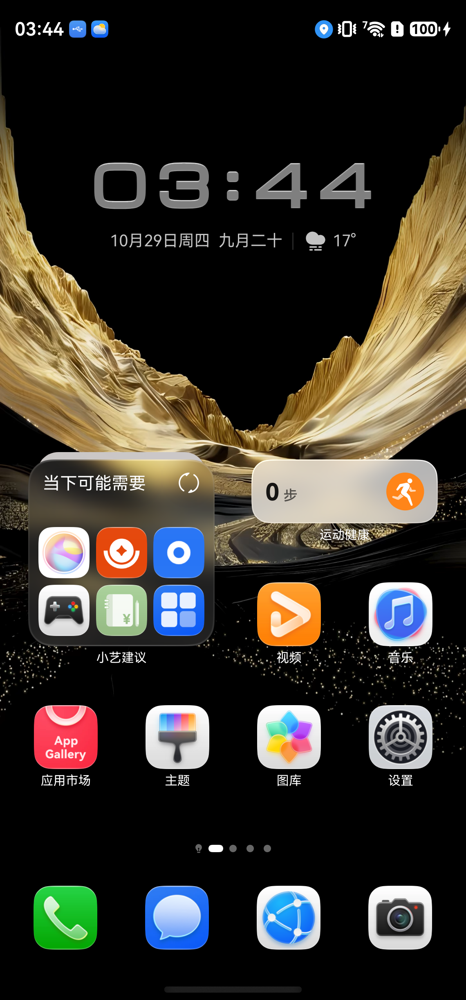
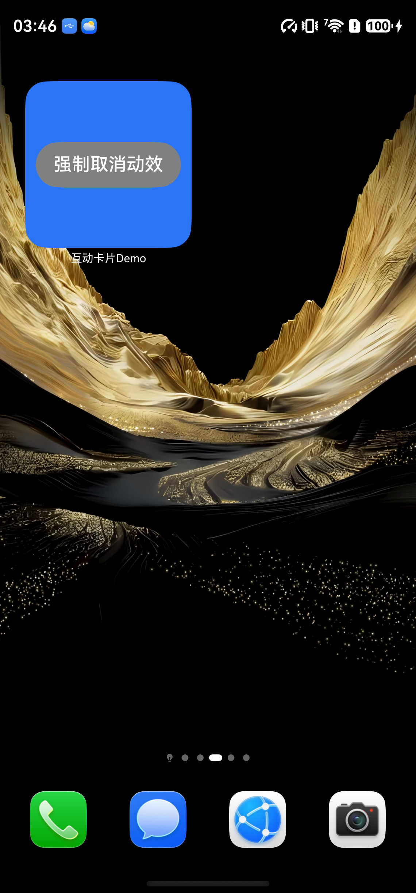
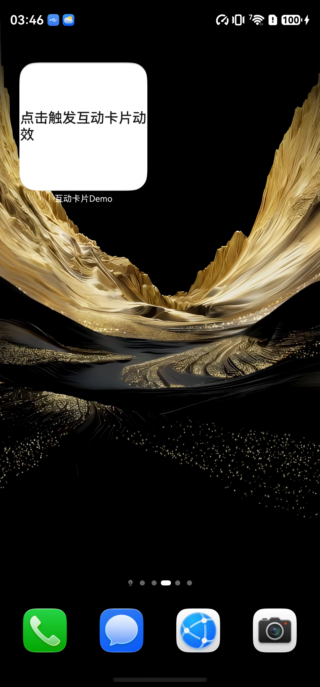

# live-form Demo 设备验证报告

## 1. 验证说明

- **验证目标**：按 Demo 顺序累计验证 live-form 特性；每个 Demo 使用各自本次冻结判据。
- **结论范围**：仅覆盖本文记录的代码、构建产物、设备环境和验证点。
- **更新规则**：新增场景和 Demo 追加；同编号、同环境、同场景重跑只替换该场景结果，保留其他场景、环境和 Demo 的记录。
- **结果口径**：构建通过不等同于设备视觉通过；没有附件的人工观察会明确标记证据限制。

| 状态 | 含义 |
|---|---|
| 待验证 | 尚未执行 |
| 通过 | 实际结果符合本次冻结判据 |
| 不通过 | 满足前提但实际结果不符合预期 |
| 无法判定 | 环境或证据不足 |
| 不适用 | 当前场景不适用 |

## 2. 验证总览

| 编号 | Demo 名称 | 环境 | 场景 | 已通过 / 适用验证点数 | 实现符合性 | 设备效果一致性 | 明细 |
|---|---|---|---|---|---|---|---|
| D01 | 互动卡片 Demo（场景动效类型） | 真机 | LF-S001 | 1 / 1 | 符合 | 音乐卡片代码移除后复验通过：点击卡片 requestOverflow 成功、激活态 UI（OverflowFormItem+强制取消动效）出现，3500ms 倒计时结束自动切回非激活态；hilog 完整记录 onLiveFormCreate（formId/borderRadius/formRect）与 onLiveFormDestroy。 | [详情](#d01-real-device-lf-s001) |
| D01 | 互动卡片 Demo（破框动效区域与取消） | 真机 | LF-S003 | 1 / 1 | 符合 | 破框区域申请、取消与超时恢复在移除音乐代码后的构建上复验通过：requestOverflow 成功且系统按 duration 3500/useDefaultAnimation true 执行；点击取消后约 0.5s 切回非激活态；不取消时 3500ms 自动切回。 | [详情](#d01-real-device-lf-s003) |

## 3. 设备验证环境

| 环境编号 | 设备型号 | HarmonyOS 完整版本 | SDK / API 版本 | HDS 版本（如适用） | 能力检测方式及结果 | 主题、字体及显示设置 |
|---|---|---|---|---|---|---|
| ENV-01 | HUAWEI Mate XT 2 | ULTIMATE DESIGN（序列号 7TZ0126602000513） | HarmonyOS（API 26 运行环境；shell 参数查询受限，以 SDK 26 声明与构建环境为准） | API 26（DevEco Studio SDK，HarmonyOS） | 不适用 | 桌面（launcher）单卡 FormLocation=DESKTOP；机型支持 requestOverflow（未返回 801），热档位 0 | 默认桌面布局，2*2 场景动效卡片 |

## 4. Demo 验证明细

### D01 互动卡片 Demo（场景动效类型）（真机）— LF-S001

#### 基本信息

| 项目 | 内容 |
|---|---|
| Demo 介绍 | 复用既有工程 live-form（D01/test-demo 为其符号链接）：场景动效互动卡片（widget/MyLiveFormExtensionAbility/MyLiveFormPage）与趣味交互卡片配置；音乐卡片相关代码已按需求移除。 |
| 工程目录 | `/Users/ming/Desktop/HarmonyProject/testproject/live-form-result/live-form/D01/test-demo` |
| 页面入口与操作路径 | 真机桌面：长按应用图标→卡片→选择“场景动效卡片”→添加至桌面；点击卡片触发动效，观察激活态与非激活态切换。 |
| 代码版本 / 安装包标识 | debug · product default · assembleApp（2026-10-29 移除音乐卡片相关代码后重建：ohpm install + hvigor --sync/--build --no-daemon） |
| 验证环境 | ENV-01 (真机) |
| 验证日期 / 验证人 | 2026-10-29 / AI（opencode · harmonyos-feature-engineering2） |
| 本次验证范围 | 激活态与非激活态切换 |

#### 官方依据

| 验证点 | 判据 ID | 本次冻结文档预期 |
|---|---|---|
| D01-01 激活态与非激活态切换 | C05、C06、C07、C08、C09 | form_config.json中通过sceneAnimationParams扩展字段关联场景动效互动卡片；仅配置sceneAnimationParams时识别为场景动效类型互动卡片。；sceneAnimationParams中abilityName为必填字符串，取值为场景动效LiveFormExtensionAbility名称。；非激活态下卡片与普通卡片行为无异，遵循既有卡片开发规范，卡片UI由卡片提供方widgetCard.ets中的内容所呈现。；激活态表示互动卡片动效渲染状态，卡片UI由卡片提供方所开发的LiveFormExtensionAbility对应page页面完成渲染。；卡片生命周期事件（如数据定时或定点刷新、用户点击等交互场景）可触发卡片动效使卡片切换至激活态，动效结束后卡片切回非激活态。 |

#### 验证点

**D01-01：激活态与非激活态切换**

验证操作：添加场景动效卡片到桌面；点击卡片触发激活态；等待 3500ms 观察自动切回。

文档预期：form_config.json中通过sceneAnimationParams扩展字段关联场景动效互动卡片；仅配置sceneAnimationParams时识别为场景动效类型互动卡片。；sceneAnimationParams中abilityName为必填字符串，取值为场景动效LiveFormExtensionAbility名称。；非激活态下卡片与普通卡片行为无异，遵循既有卡片开发规范，卡片UI由卡片提供方widgetCard.ets中的内容所呈现。；激活态表示互动卡片动效渲染状态，卡片UI由卡片提供方所开发的LiveFormExtensionAbility对应page页面完成渲染。；卡片生命周期事件（如数据定时或定点刷新、用户点击等交互场景）可触发卡片动效使卡片切换至激活态，动效结束后卡片切回非激活态。

参数与结果：

| 变体 | 参数 | 设备结果 |
|---|---|---|
| 非激活态基线 | `{"state":"inactive"}` | 普通卡片形态：文案“点击触发互动卡片动效”，无破框区域。 |
| 场景动效激活态 | `{"state":"active"}` | 激活态形态：破框渲染区域扩展到卡片外，出现“强制取消动效”按钮，3500ms 内有效。 |

设备结果：非激活态显示“点击触发互动卡片动效”；点击后组件树出现 OverflowFormItem 与“强制取消动效”按钮；hilog 记录 requestOverflow succeed→onLiveFormCreate（formId 1263917827, borderRadius 18.97, formRect 146x146vp）→3500ms 后 onLiveFormDestroy。

验证状态：**通过**。激活态 UI 承载者（LiveFormExtensionAbility page）与非激活态承载者（widgetCard.ets）及切换时序均与冻结判据一致。

- [激活态组件树](D01/evidence/device/ct-activated.json)

- [hilog 调用链摘录](D01/evidence/device/hilog-liveform-all.txt)

#### 设备证据说明

非激活态/激活态/自动切回截图与激活态组件树、hilog 摘录见 D01/evidence/device/（均为移除后新构建采集）。

#### 符合性结论

| 结论项 | 结果 | 依据 / 说明 |
|---|---|---|
| 代码实现是否符合开发指南 | 符合 | 实现与官网场景动效开发指导示例一致：module.json5 声明 liveForm 扩展、form_config 配置 sceneAnimationParams.abilityName、非激活态 widgetCard.ets 承载、激活态由 LiveFormExtensionAbility 加载 MyLiveFormPage 渲染；全部判据可从代码行反查冻结快照锚点。 |
| 设备效果是否符合文档预期 | 1 / 1 | 音乐卡片代码移除后复验通过：点击卡片 requestOverflow 成功、激活态 UI（OverflowFormItem+强制取消动效）出现，3500ms 倒计时结束自动切回非激活态；hilog 完整记录 onLiveFormCreate（formId/borderRadius/formRect）与 onLiveFormDestroy。 |
| 自动验证与人工验证关系 | devecocli ui 自动化（longclick/click/layout/screenshot）+ hdc hilog 取证 | 卡片添加、点击与截图由 devecocli ui 注入；状态判定基于设备组件树与系统日志。 |
| 是否发现疑似文档问题 | 无（本轮未发现官网步骤错误） | 官网开发步骤（声明→配置→非激活态→激活态→触发动效）在本 demo 全部走通。 |
| 未覆盖项及结论限制 | 未验证摇一摇触发（LF-S004 范畴）、多卡片竞争与省电/热档位抑制；未覆盖其他尺寸的场景动效卡片。 | 验证点采用最小充分集合（激活态/非激活态切换）。 |

### D01 互动卡片 Demo（破框动效区域与取消）（真机）— LF-S003

#### 基本信息

| 项目 | 内容 |
|---|---|
| Demo 介绍 | 复用既有工程 live-form（D01/test-demo 为其符号链接）：EntryFormAbility.onFormEvent 经 getFormRect 计算动效区域并 requestOverflow（duration 3500/useDefaultAnimation true），激活态页面提供 cancelOverflow 按钮；音乐卡片相关代码已按需求移除。 |
| 工程目录 | `/Users/ming/Desktop/HarmonyProject/testproject/live-form-result/live-form/D01/test-demo` |
| 页面入口与操作路径 | 真机桌面场景动效卡片：点击触发破框；动效期间点击“强制取消动效”验证取消；再次触发后不操作验证 3500ms 超时切回。 |
| 代码版本 / 安装包标识 | debug · product default · assembleApp（2026-10-29 移除音乐卡片相关代码后重建：ohpm install + hvigor --sync/--build --no-daemon） |
| 验证环境 | ENV-01 (真机) |
| 验证日期 / 验证人 | 2026-10-29 / AI（opencode · harmonyos-feature-engineering2） |
| 本次验证范围 | 破框区域与取消恢复 |

#### 官方依据

| 验证点 | 判据 ID | 本次冻结文档预期 |
|---|---|---|
| D03-01 破框区域与取消恢复 | C03、C04、C05、C06、C07、C08 | overflowInfo.area描述互动卡片动效区域范围，以卡片左上角为原点；申请区域需包含卡片自身渲染区域（矩形ABCD）的全部区域，且不超过最大可申请动效区域矩形IJKL。；调用requestOverflow时动效渲染区域（矩形EFGH）需要满足：包含卡片（矩形ABCD）的全部区域；不超过矩形IJKL（矩形IJKL完整包含矩形EFGH）。；overflowInfo.duration为互动卡片动效持续时长（单位ms），取值为大于等于0的整数，取值要求不大于3500；互动卡片申请动效的最大合法动效时长为3500ms，倒计时结束时卡片切换回非激活态。；overflowInfo.useDefaultAnimation表示互动卡片状态切换时是否启动系统提供的默认动效，默认为true；false表示系统不提供切换动效，画面直接切换，适合切换时非激活态和激活态UI完全一致的场景。；cancelOverflow(formId)由卡片提供方发起取消互动卡片动效请求，用于取消已发起的动效；效果demo中点击按钮调用该接口打断当前破框动效后，卡片切换为非激活态。；互动卡片申请动效的最大合法动效时长为3500ms，倒计时结束时卡片将切换回非激活态。 |

#### 验证点

**D03-01：破框区域与取消恢复**

验证操作：点击卡片触发破框动效；动效期间点击“强制取消动效”；再次触发并等待 3500ms。

文档预期：overflowInfo.area描述互动卡片动效区域范围，以卡片左上角为原点；申请区域需包含卡片自身渲染区域（矩形ABCD）的全部区域，且不超过最大可申请动效区域矩形IJKL。；调用requestOverflow时动效渲染区域（矩形EFGH）需要满足：包含卡片（矩形ABCD）的全部区域；不超过矩形IJKL（矩形IJKL完整包含矩形EFGH）。；overflowInfo.duration为互动卡片动效持续时长（单位ms），取值为大于等于0的整数，取值要求不大于3500；互动卡片申请动效的最大合法动效时长为3500ms，倒计时结束时卡片切换回非激活态。；overflowInfo.useDefaultAnimation表示互动卡片状态切换时是否启动系统提供的默认动效，默认为true；false表示系统不提供切换动效，画面直接切换，适合切换时非激活态和激活态UI完全一致的场景。；cancelOverflow(formId)由卡片提供方发起取消互动卡片动效请求，用于取消已发起的动效；效果demo中点击按钮调用该接口打断当前破框动效后，卡片切换为非激活态。；互动卡片申请动效的最大合法动效时长为3500ms，倒计时结束时卡片将切换回非激活态。

参数与结果：

| 变体 | 参数 | 设备结果 |
|---|---|---|
| 卡片区域基线 | `{"overflow":"none"}` | 非激活态基线：卡片内容限定在自身渲染区域内，无溢出。 |
| 合法破框区域 | `{"overflow":"criteria_derived"}` | 合法破框：渲染区域扩展至卡片外（不超过 2*2 卡片 150% 上限），3500ms 内有效。 |

交互验证：

| 交互项 | 操作要求 | 预期 | 设备结果 | 状态 |
|---|---|---|---|---|
| trigger-overflow | 从用户点名的入口发起破框动效。 | 合法请求进入激活态并显示本次判据允许的破框区域。 | 点击卡片→message→onFormEvent→getFormRect→requestOverflow succeed；系统日志显示 duration: 3500、useDefaultAnimation: true。 | **通过**。与判据的申请链路和参数一致。 |
| cancel-overflow | 在动效执行期间触发取消。 | 动效停止并恢复到本次判据定义的非激活态。 | 点击“强制取消动效”后 cancelOverflow 生效，动效停止并恢复非激活态（约 0.5s，远早于 3500ms 超时）。 | **通过**。取消路径与判据一致。 |

设备结果：合法请求进入激活态并出现破框区域；取消点击后 hilog 记录 MyLiveFormPage cancel overflow animation，约 0.5s 后 onLiveFormDestroy；未取消时系统在 duration 3500 倒计时结束自动切回非激活态。

验证状态：**通过**。申请区域、时长与切换参数符合判据；取消与超时恢复路径均观察到系统按冻结正文执行。

- 破框激活态：[查看已展示证据](#evidence-2)

- 超时自动切回：[查看已展示证据](#evidence-3)
- hilog 摘录：[查看已展示证据](#evidence-5)

#### 设备证据说明

激活/取消/超时三态截图、取消后组件树与 hilog 摘录见 D01/evidence/device/。

#### 符合性结论

| 结论项 | 结果 | 依据 / 说明 |
|---|---|---|
| 代码实现是否符合开发指南 | 符合 | 动效区域以卡片左上角为原点按 0.1/0.15/1.2/1.3 比例计算（2*2 卡片不超过 150%/150% 上限且包含卡片全部区域），duration=3500，useDefaultAnimation=true，均与冻结判据一致。 |
| 设备效果是否符合文档预期 | 1 / 1 | 破框区域申请、取消与超时恢复在移除音乐代码后的构建上复验通过：requestOverflow 成功且系统按 duration 3500/useDefaultAnimation true 执行；点击取消后约 0.5s 切回非激活态；不取消时 3500ms 自动切回。 |
| 自动验证与人工验证关系 | devecocli ui 自动化（longclick/click/layout/screenshot）+ hdc hilog 取证 | 卡片添加、点击与截图由 devecocli ui 注入；状态判定基于设备组件树与系统日志。 |
| 是否发现疑似文档问题 | 无（本轮未发现官网步骤错误） | 官网破框申请-取消-超时约束在真机全部复现，与冻结正文一致。 |
| 未覆盖项及结论限制 | 未触发非法区域/超时长参数的系统拒绝路径（801/16501000 仅代码路径覆盖）；未覆盖其他卡片尺寸的区域比例矩阵。 | 验证点采用最小充分集合（合法破框+取消+超时恢复）。 |

## 5. 证据文件约定

- 设备证据按 Demo 和验证点保存，并关联源码版本、构建产物哈希和参数变体。
- 动态效果使用录屏；静态截图不能单独证明连续动画或交互轨迹。
- 不存在的附件不生成链接，不创建占位截图。

## 6. 运行验证问题与待确认异常

按严重度 Blocker → High → Medium → Low → Suggestion 排序；未评定严重度列在最后。无法判定项保留实际状态，不认定为已确认官网错误。

未记录问题或待确认异常。

